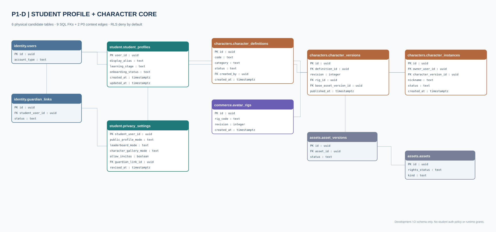

# P1-D Student/Character Physical ERD — SQL truth
**Candidate in PR #27 · DEV/CI PostgreSQL only.** [Open editable Draw.io](Student_Character_Core_Physical.drawio) · [SVG overview](Student_Character_Core_Physical.svg)

The 30-page [Student Universe design Draw.io](Student_Universe_Editable.drawio) models **22 future tables** and their proposed FKs. This **SQL-derived physical diagram** shows **six physically-created candidate tables** and direct P0 dependencies. It is NOT an implementation of inventory, Coin wallets or grade data.

| Domain | Physical candidate tables | Foreign keys to upstream |
|---|---|---|
| Student | `student_profiles`, `privacy_settings` | `identity.users` and `identity.guardian_links` |
| Characters | `character_definitions`, `character_versions`, `character_instances` | `identity.users`, `student.student_profiles`, `assets.asset_versions`, `commerce.avatar_rigs` |
| Commerce foundation | `avatar_rigs` | Single P1 canonical rig table; no duplicate future rig catalog |

**9 new SQL FK edges** plus **2 existing P0 edges** drawn as context. SSO/guardian security remains a runtime gate and RLS DENY-ALL: no application role can write/read this schema until separate permission review.

Regenerate strictly from `db/migrations/0003_student_character_core_candidate.sql` using `node scripts/generate_student_physical_erd.mjs`; `--check` is run in CI. PostgreSQL constraints and negative tests remain the definitive verification source.
