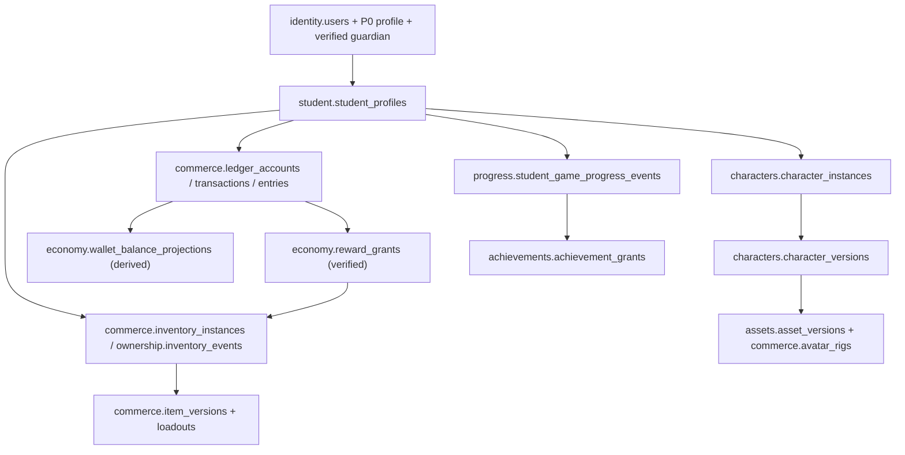

# Student Universe — AI Agent Starting Point

**No production implementation exists for these additional 22 tables.** This is a design-only extension, integrated with 30 P0 and 39 P1 table models. The **P1 Education SQL is pending PR #21**, and the proposed P1 Commerce wallet/inventory tables are not physically migrated.

## Read in this order
1. [Original P0 schema and ERD](../README.md), [P1 39-table atlas](../p1/README.md).
2. [Student Universe complete data dictionary and 22 direct table diagrams](README.md).
3. [Editable Student Universe Draw.io (30 pages)](Student_Universe_Editable.drawio).
4. [Student Data → Backend → Frontend contract and ownership/security flows](IMPLEMENTATION_AND_SECURITY_CONTRACT.md).
5. [20 unresolved owner decisions](DECISION_REGISTER.md).
6. Canonical machine-readable candidate [manifest](../../../db/schema/student_universe_extension_candidate.json) used by the CI parity check.

## Suggested top-down ownership map

**Do not collapse profile, student-owned character, item inventory, creative asset, Coin balance, experience or academic rubric into a single mutable JSON field.** Their ownership, security and history have different rules.

## Workflow after human review
Approved cross-layer flow/screen → physical SQL migration + composite FK/unique/immutable guards + deny-by-default RLS → PostgreSQL negative/concurrency tests → backend service and typed DTO with SSO/guardian scope → frontend private read-model and accessible states → staging security QA. No CI job may deploy production tables or grant virtual currency automatically.
