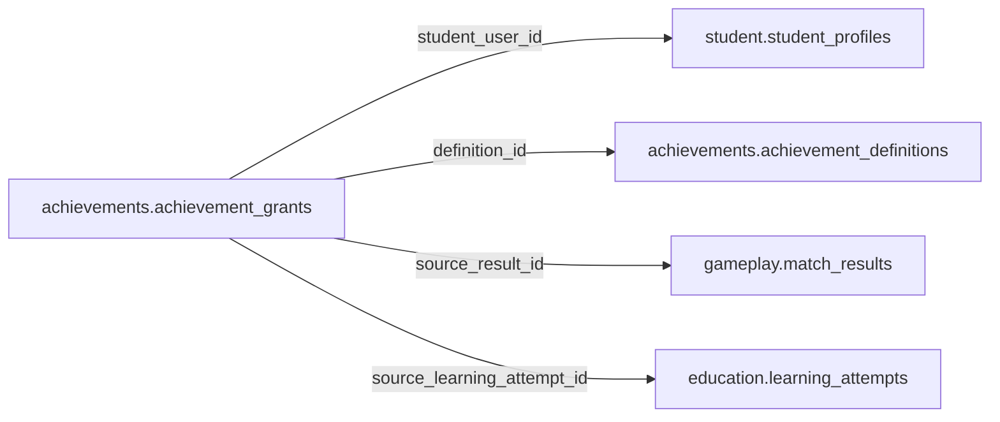

# achievements.achievement_grants

> Design candidate — no physical migration.

Học sinh nhận thành tích với nguồn xác minh và phạm vi hiển thị độc lập.

## Direct relationships

## Proposed columns
| Column | Type | PK | FK | Nullable |
|---|---|---|---|---|
| `id` | `uuid` | Yes | — | No |
| `student_user_id` | `uuid` | No | student.student_profiles.user_id | No |
| `definition_id` | `uuid` | No | achievements.achievement_definitions.id | No |
| `source_result_id` | `uuid` | No | gameplay.match_results.id | Yes |
| `source_learning_attempt_id` | `uuid` | No | education.learning_attempts.id | Yes |
| `grant_key` | `text` | No | — | No |
| `visible_publicly` | `boolean` | No | — | No |
| `granted_at` | `timestamptz` | No | — | No |

## Business/security invariants
- grant unique by eligibility source
- not equivalent to score, grade, wallet credit or item ownership
- public display requires separate guardian/age review

Student ownership, guardian permissions and least-privilege RLS require independent verification before enabling API writes.
