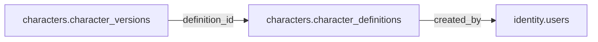

# characters.character_definitions

> Design candidate — no physical migration.

Mẫu nhân vật trong danh mục; chưa phải nhân vật học sinh sở hữu.

## Direct relationships

## Proposed columns
| Column | Type | PK | FK | Nullable |
|---|---|---|---|---|
| `id` | `uuid` | Yes | — | No |
| `code` | `text` | No | — | No |
| `category` | `text` | No | — | No |
| `status` | `text` | No | — | No |
| `created_by` | `uuid` | No | identity.users.id | No |
| `created_at` | `timestamptz` | No | — | No |

## Business/security invariants
- published character catalog is immutable via versioning

Student ownership, guardian permissions and least-privilege RLS require independent verification before enabling API writes.
