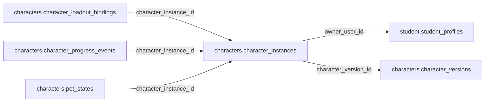

# characters.character_instances

> Design candidate — no physical migration.

Nhân vật riêng của học sinh; nhiều nhân vật với nickname được kiểm duyệt.

## Direct relationships

## Proposed columns
| Column | Type | PK | FK | Nullable |
|---|---|---|---|---|
| `id` | `uuid` | Yes | — | No |
| `owner_user_id` | `uuid` | No | student.student_profiles.user_id | No |
| `character_version_id` | `uuid` | No | characters.character_versions.id | No |
| `nickname` | `text` | No | — | No |
| `status` | `text` | No | — | No |
| `created_at` | `timestamptz` | No | — | No |

## Business/security invariants
- owner immutable except approved compensation
- one user can own multiple character instances
- no resale/trade among minors

Student ownership, guardian permissions and least-privilege RLS require independent verification before enabling API writes.
