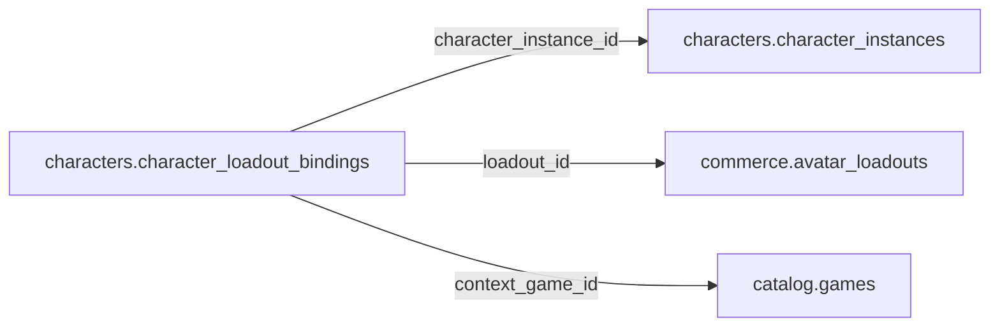

# characters.character_loadout_bindings

> Design candidate — no physical migration.

Gắn nhân vật sở hữu với avatar loadout theo game/context.

## Direct relationships

## Proposed columns
| Column | Type | PK | FK | Nullable |
|---|---|---|---|---|
| `id` | `uuid` | Yes | — | No |
| `character_instance_id` | `uuid` | No | characters.character_instances.id | No |
| `loadout_id` | `uuid` | No | commerce.avatar_loadouts.id | No |
| `context_game_id` | `uuid` | No | catalog.games.id | Yes |
| `is_active` | `boolean` | No | — | No |
| `updated_at` | `timestamptz` | No | — | No |

## Business/security invariants
- character owner == loadout owner (server and DB guard)
- one active loadout per character+context; partial unique index
- all equipped item instances owned by same user

Student ownership, guardian permissions and least-privilege RLS require independent verification before enabling API writes.
