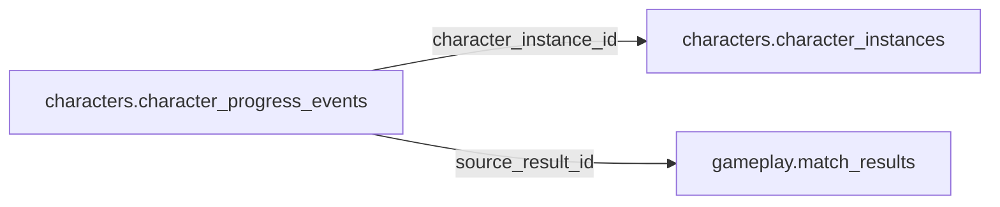

# characters.character_progress_events

> Design candidate — no physical migration.

Tiến trình nhân vật append-only, EXP không phải Coin; nguồn game đã xác minh.

## Direct relationships

## Proposed columns
| Column | Type | PK | FK | Nullable |
|---|---|---|---|---|
| `id` | `uuid` | Yes | — | No |
| `character_instance_id` | `uuid` | No | characters.character_instances.id | No |
| `source_result_id` | `uuid` | No | gameplay.match_results.id | Yes |
| `event_key` | `text` | No | — | No |
| `event_type` | `text` | No | — | No |
| `exp_delta` | `bigint` | No | — | No |
| `recorded_at` | `timestamptz` | No | — | No |

## Business/security invariants
- append only; signed source and idempotency
- exp level never automatically credits wallet

Student ownership, guardian permissions and least-privilege RLS require independent verification before enabling API writes.
