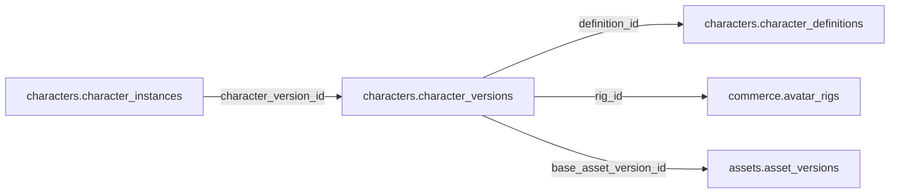

# characters.character_versions

> Design candidate — no physical migration.

Phiên bản mẫu gắn rig canonical và asset GLB đã duyệt.

## Direct relationships

## Proposed columns
| Column | Type | PK | FK | Nullable |
|---|---|---|---|---|
| `id` | `uuid` | Yes | — | No |
| `definition_id` | `uuid` | No | characters.character_definitions.id | No |
| `revision` | `integer` | No | — | No |
| `rig_id` | `uuid` | No | commerce.avatar_rigs.id | No |
| `base_asset_version_id` | `uuid` | No | assets.asset_versions.id | No |
| `manifest_sha256` | `text` | No | — | No |
| `published_at` | `timestamptz` | No | — | Yes |

## Business/security invariants
- asset rights approved; GLB rig compatible
- revision > 0; published row immutable
- never embed remote unapproved asset URLs

Student ownership, guardian permissions and least-privilege RLS require independent verification before enabling API writes.
