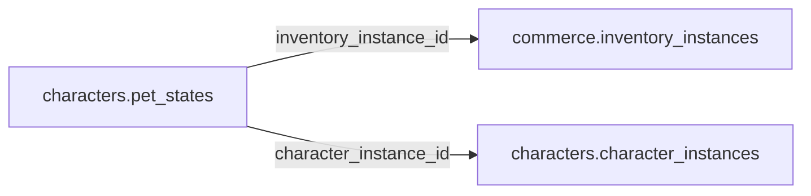

# characters.pet_states

> Design candidate — no physical migration.

Tùy chọn pet được đại diện bởi inventory_instance đã sở hữu; không tạo bản sao quyền sở hữu.

## Direct relationships

## Proposed columns
| Column | Type | PK | FK | Nullable |
|---|---|---|---|---|
| `inventory_instance_id` | `uuid` | Yes | commerce.inventory_instances.id | No |
| `character_instance_id` | `uuid` | No | characters.character_instances.id | Yes |
| `state_version` | `integer` | No | — | No |
| `pet_state` | `jsonb` | No | — | No |
| `updated_at` | `timestamptz` | No | — | No |

## Business/security invariants
- pet item owner must match attached character owner
- pet cosmetics never alter competitive hitbox
- pet_state allowlisted schema, no arbitrary binary code

Student ownership, guardian permissions and least-privilege RLS require independent verification before enabling API writes.
