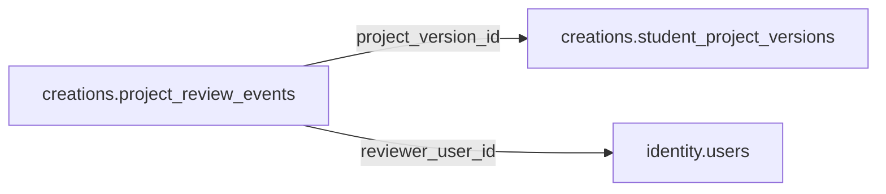

# creations.project_review_events

> Design candidate — no physical migration.

Biên bản kiểm duyệt riêng từng version, có người duyệt và lý do đã lọc PII.

## Direct relationships

## Proposed columns
| Column | Type | PK | FK | Nullable |
|---|---|---|---|---|
| `id` | `uuid` | Yes | — | No |
| `project_version_id` | `uuid` | No | creations.student_project_versions.id | No |
| `reviewer_user_id` | `uuid` | No | identity.users.id | No |
| `decision` | `text` | No | — | No |
| `review_note_redacted` | `text` | No | — | Yes |
| `reviewed_at` | `timestamptz` | No | — | No |

## Business/security invariants
- append only, reviewer cannot self approve
- public release requires verified approval and guardian policy

Student ownership, guardian permissions and least-privilege RLS require independent verification before enabling API writes.
