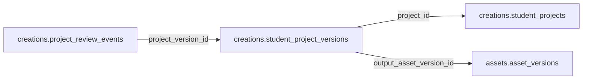

# creations.student_project_versions

> Design candidate — no physical migration.

Lịch sử version của project: source editable và asset đầu ra được kiểm duyệt.

## Direct relationships

## Proposed columns
| Column | Type | PK | FK | Nullable |
|---|---|---|---|---|
| `id` | `uuid` | Yes | — | No |
| `project_id` | `uuid` | No | creations.student_projects.id | No |
| `revision` | `integer` | No | — | No |
| `source_hash` | `text` | No | — | No |
| `source_storage_key` | `text` | No | — | No |
| `output_asset_version_id` | `uuid` | No | assets.asset_versions.id | Yes |
| `created_at` | `timestamptz` | No | — | No |

## Business/security invariants
- immutable revision + object ownership
- source_storage_key private; signed access only
- GLB/texture licensing and safe content scanning

Student ownership, guardian permissions and least-privilege RLS require independent verification before enabling API writes.
