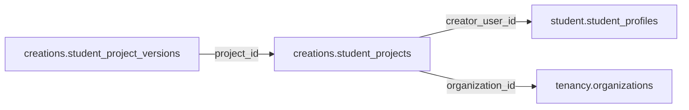

# creations.student_projects

> Design candidate — no physical migration.

Sản phẩm học sinh tự tạo được tách khỏi asset catalog đã duyệt.

## Direct relationships

## Proposed columns
| Column | Type | PK | FK | Nullable |
|---|---|---|---|---|
| `id` | `uuid` | Yes | — | No |
| `creator_user_id` | `uuid` | No | student.student_profiles.user_id | No |
| `organization_id` | `uuid` | No | tenancy.organizations.id | Yes |
| `project_type` | `text` | No | — | No |
| `title` | `text` | No | — | No |
| `visibility` | `text` | No | — | No |
| `status` | `text` | No | — | No |
| `created_at` | `timestamptz` | No | — | No |

## Business/security invariants
- default private; ownership/guardian moderation required
- no direct publication to public asset CDN

Student ownership, guardian permissions and least-privilege RLS require independent verification before enabling API writes.
