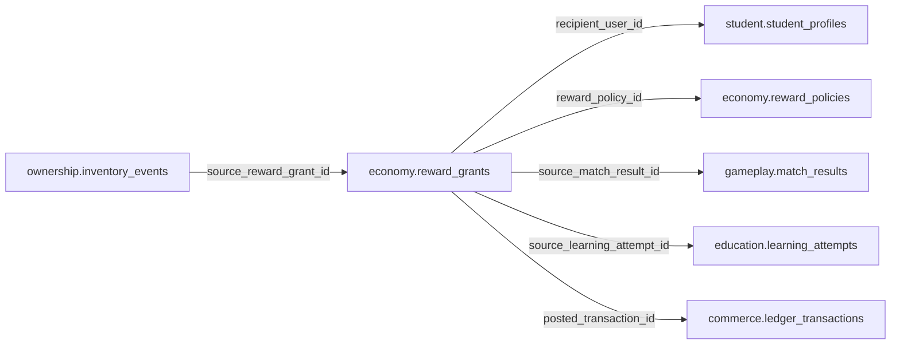

# economy.reward_grants

> Design candidate — no physical migration.

Biên nhận phát Coin hoặc item; chỉ posted sau khi ledger và inventory commit.

## Direct relationships

## Proposed columns
| Column | Type | PK | FK | Nullable |
|---|---|---|---|---|
| `id` | `uuid` | Yes | — | No |
| `recipient_user_id` | `uuid` | No | student.student_profiles.user_id | No |
| `reward_policy_id` | `uuid` | No | economy.reward_policies.id | No |
| `source_match_result_id` | `uuid` | No | gameplay.match_results.id | Yes |
| `source_learning_attempt_id` | `uuid` | No | education.learning_attempts.id | Yes |
| `posted_transaction_id` | `uuid` | No | commerce.ledger_transactions.id | Yes |
| `source_event_key` | `text` | No | — | No |
| `status` | `text` | No | — | No |
| `awarded_at` | `timestamptz` | No | — | Yes |
| `created_at` | `timestamptz` | No | — | No |

## Business/security invariants
- idempotent, exact verified source and non-self-grant
- reward postings and inventory grant atomic/replay safe
- no automatic grade-to-Coin promise

Student ownership, guardian permissions and least-privilege RLS require independent verification before enabling API writes.
