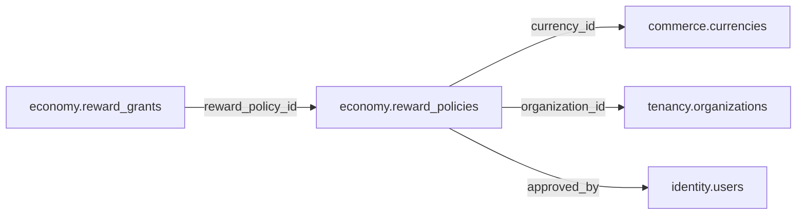

# economy.reward_policies

> Design candidate — no physical migration.

Quy tắc phát Coin/đồ theo nguồn đạt chuẩn, revision immutable.

## Direct relationships

## Proposed columns
| Column | Type | PK | FK | Nullable |
|---|---|---|---|---|
| `id` | `uuid` | Yes | — | No |
| `policy_code` | `text` | No | — | No |
| `revision` | `integer` | No | — | No |
| `currency_id` | `uuid` | No | commerce.currencies.id | Yes |
| `organization_id` | `uuid` | No | tenancy.organizations.id | Yes |
| `max_units_per_event` | `bigint` | No | — | No |
| `approved_by` | `uuid` | No | identity.users.id | No |
| `effective_from` | `timestamptz` | No | — | No |
| `status` | `text` | No | — | No |

## Business/security invariants
- closed loop only, cannot buy real goods or cash out
- valid source evidence, reward caps and rate limits
- guardian/age policy verified in service

Student ownership, guardian permissions and least-privilege RLS require independent verification before enabling API writes.
