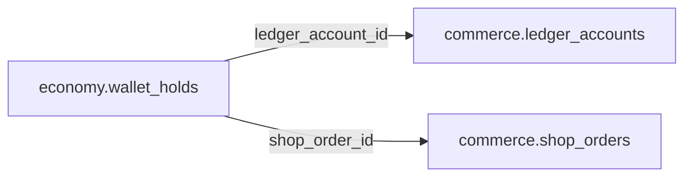

# economy.wallet_holds

> Design candidate — no physical migration.

Giữ Coin cho đơn hàng chờ xử lý, có TTL/idempotency.

## Direct relationships

## Proposed columns
| Column | Type | PK | FK | Nullable |
|---|---|---|---|---|
| `id` | `uuid` | Yes | — | No |
| `ledger_account_id` | `uuid` | No | commerce.ledger_accounts.id | No |
| `shop_order_id` | `uuid` | No | commerce.shop_orders.id | Yes |
| `hold_key` | `text` | No | — | No |
| `amount_units` | `bigint` | No | — | No |
| `status` | `text` | No | — | No |
| `expires_at` | `timestamptz` | No | — | No |
| `created_at` | `timestamptz` | No | — | No |

## Business/security invariants
- amount_units > 0
- available after holds must never be negative
- atomic lock and release/consume under database transaction

Student ownership, guardian permissions and least-privilege RLS require independent verification before enabling API writes.
