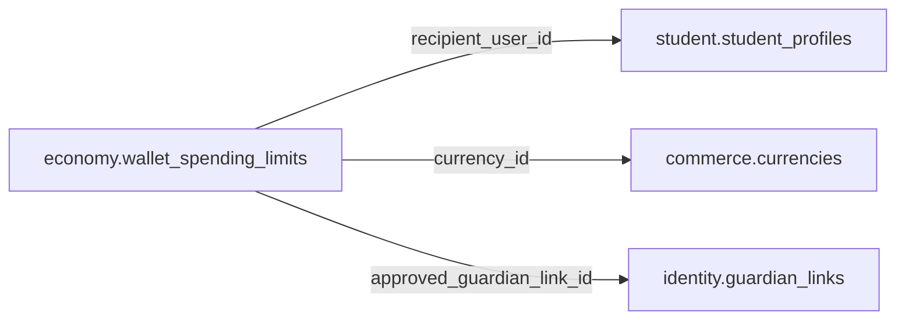

# economy.wallet_spending_limits

> Design candidate — no physical migration.

Ngưỡng chi tiêu Coin theo người, loại tiền và kỳ hiệu lực.

## Direct relationships

## Proposed columns
| Column | Type | PK | FK | Nullable |
|---|---|---|---|---|
| `id` | `uuid` | Yes | — | No |
| `recipient_user_id` | `uuid` | No | student.student_profiles.user_id | No |
| `currency_id` | `uuid` | No | commerce.currencies.id | No |
| `period_code` | `text` | No | — | No |
| `max_spend_units` | `bigint` | No | — | No |
| `effective_from` | `timestamptz` | No | — | No |
| `approved_guardian_link_id` | `uuid` | No | identity.guardian_links.id | Yes |
| `status` | `text` | No | — | No |

## Business/security invariants
- limits by age/guardian and policy, not user-controlled
- actual spend derived from posted ledger
- no self-elevated limit edits

Student ownership, guardian permissions and least-privilege RLS require independent verification before enabling API writes.
