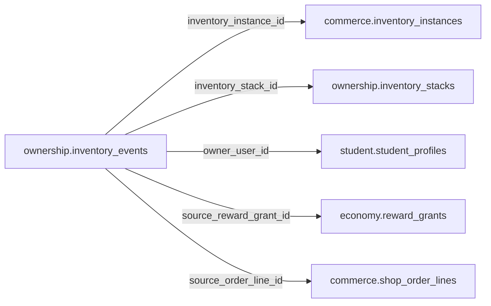

# ownership.inventory_events

> Design candidate — no physical migration.

Ledger quyền sở hữu items: grant, revoke, equip, consumption; immutable.

## Direct relationships

## Proposed columns
| Column | Type | PK | FK | Nullable |
|---|---|---|---|---|
| `id` | `uuid` | Yes | — | No |
| `inventory_instance_id` | `uuid` | No | commerce.inventory_instances.id | Yes |
| `inventory_stack_id` | `uuid` | No | ownership.inventory_stacks.id | Yes |
| `owner_user_id` | `uuid` | No | student.student_profiles.user_id | No |
| `source_reward_grant_id` | `uuid` | No | economy.reward_grants.id | Yes |
| `source_order_line_id` | `uuid` | No | commerce.shop_order_lines.id | Yes |
| `event_type` | `text` | No | — | No |
| `quantity_delta` | `integer` | No | — | No |
| `event_key` | `text` | No | — | No |
| `occurred_at` | `timestamptz` | No | — | No |

## Business/security invariants
- exactly one of inventory_instance or inventory_stack
- no owner transfer for minors
- at least one verified grant/order/audited admin source
- append-only; no silent deletion

Student ownership, guardian permissions and least-privilege RLS require independent verification before enabling API writes.
