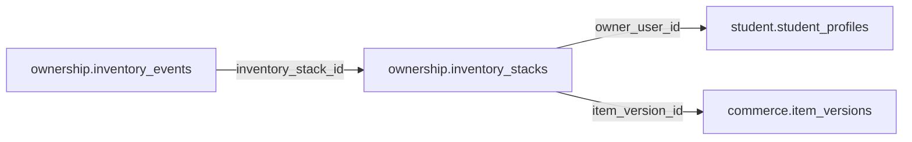

# ownership.inventory_stacks

> Design candidate — no physical migration.

Số lượng vật phẩm stackable, tách khỏi mỗi bản thể inventory_instances.

## Direct relationships

## Proposed columns
| Column | Type | PK | FK | Nullable |
|---|---|---|---|---|
| `id` | `uuid` | Yes | — | No |
| `owner_user_id` | `uuid` | No | student.student_profiles.user_id | No |
| `item_version_id` | `uuid` | No | commerce.item_versions.id | No |
| `available_qty` | `integer` | No | — | No |
| `reserved_qty` | `integer` | No | — | No |
| `revision` | `bigint` | No | — | No |
| `updated_at` | `timestamptz` | No | — | No |

## Business/security invariants
- available_qty >= 0 and reserved_qty >= 0
- stack cache must reconcile with immutable inventory_events
- lock rows for concurrent equipment/consume

Student ownership, guardian permissions and least-privilege RLS require independent verification before enabling API writes.
