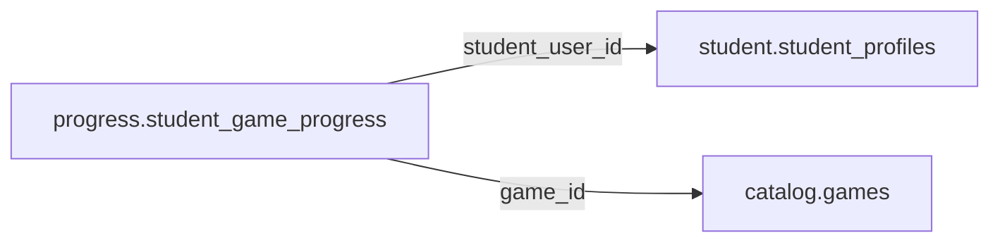

# progress.student_game_progress

> Design candidate — no physical migration.

Projection tiến trình học sinh theo game; rebuild từ verified progress events.

## Direct relationships

## Proposed columns
| Column | Type | PK | FK | Nullable |
|---|---|---|---|---|
| `id` | `uuid` | Yes | — | No |
| `student_user_id` | `uuid` | No | student.student_profiles.user_id | No |
| `game_id` | `uuid` | No | catalog.games.id | No |
| `total_exp` | `bigint` | No | — | No |
| `game_level` | `integer` | No | — | No |
| `source_revision` | `bigint` | No | — | No |
| `calculated_at` | `timestamptz` | No | — | No |

## Business/security invariants
- read-model only; EXP not currency or school grade
- source_revision monotonic; private by default

Student ownership, guardian permissions and least-privilege RLS require independent verification before enabling API writes.
