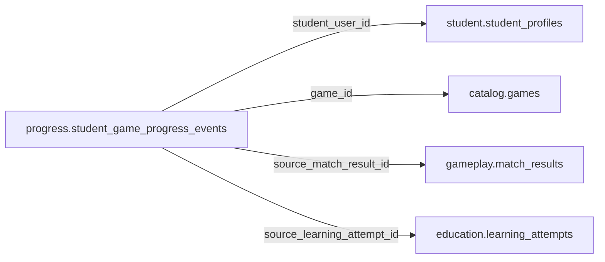

# progress.student_game_progress_events

> Design candidate — no physical migration.

Tiến trình liên game ghi append-only, chỉ nhận nguồn đã xác thực.

## Direct relationships

## Proposed columns
| Column | Type | PK | FK | Nullable |
|---|---|---|---|---|
| `id` | `uuid` | Yes | — | No |
| `student_user_id` | `uuid` | No | student.student_profiles.user_id | No |
| `game_id` | `uuid` | No | catalog.games.id | No |
| `source_match_result_id` | `uuid` | No | gameplay.match_results.id | Yes |
| `source_learning_attempt_id` | `uuid` | No | education.learning_attempts.id | Yes |
| `event_key` | `text` | No | — | No |
| `exp_delta` | `bigint` | No | — | No |
| `recorded_at` | `timestamptz` | No | — | No |

## Business/security invariants
- event source verified; academic feedback remains private
- idempotent events, corrections via compensating delta

Student ownership, guardian permissions and least-privilege RLS require independent verification before enabling API writes.
