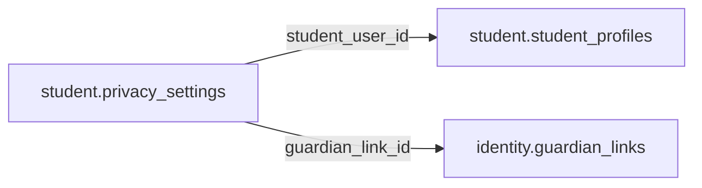

# student.privacy_settings

> Design candidate — no physical migration.

Quyền hiển thị hồ sơ và nhân vật, mặc định riêng tư; nguồn ủy quyền guardian chỉ từ verified link.

## Direct relationships

## Proposed columns
| Column | Type | PK | FK | Nullable |
|---|---|---|---|---|
| `student_user_id` | `uuid` | Yes | student.student_profiles.user_id | No |
| `public_profile_mode` | `text` | No | — | No |
| `leaderboard_mode` | `text` | No | — | No |
| `character_gallery_mode` | `text` | No | — | No |
| `allow_invites` | `boolean` | No | — | No |
| `guardian_link_id` | `uuid` | No | identity.guardian_links.id | Yes |
| `revised_at` | `timestamptz` | No | — | No |

## Business/security invariants
- minor has no unrestricted public/profile messaging by default
- a guardian link must be verified AND match student before using as consent
- separate audit for visibility changes

Student ownership, guardian permissions and least-privilege RLS require independent verification before enabling API writes.
