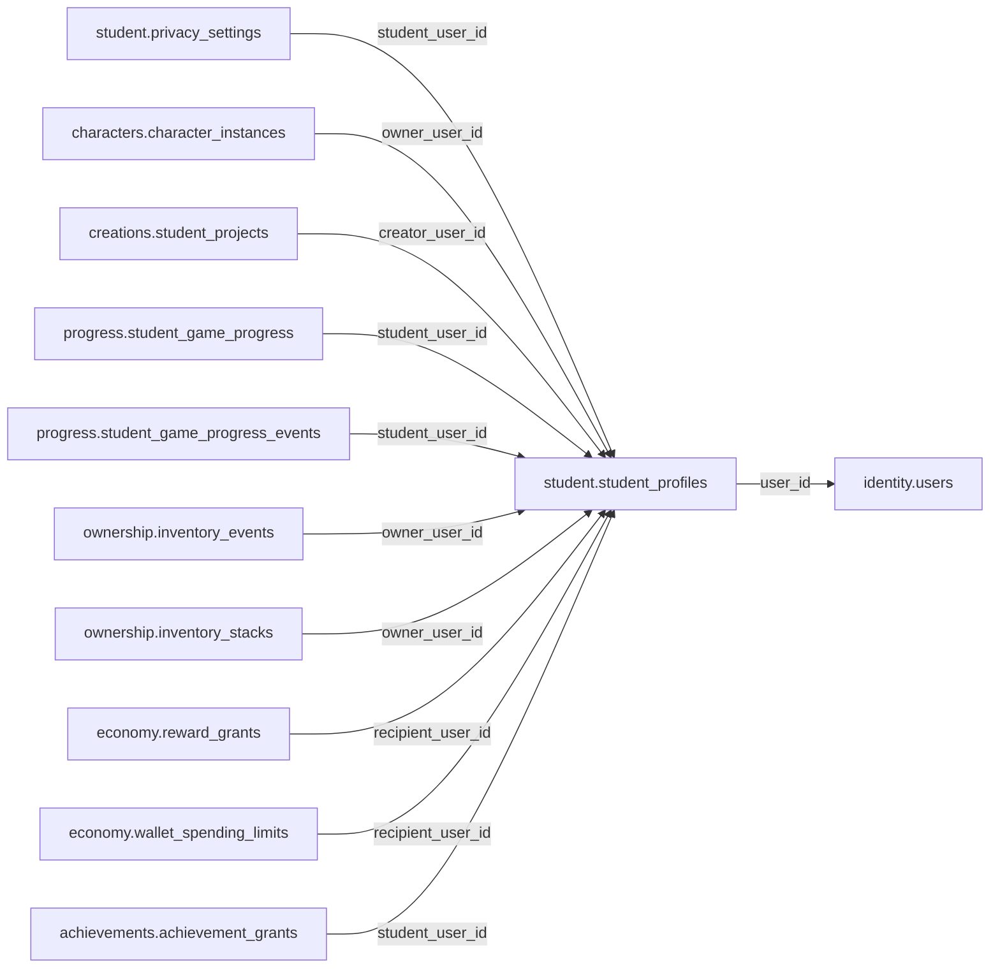

# student.student_profiles

> Design candidate — no physical migration.

Hồ sơ học sinh bảo mật theo user global; không sao chép họ tên, ngày sinh hoặc mật khẩu từ KingDragonHub.

## Direct relationships

## Proposed columns
| Column | Type | PK | FK | Nullable |
|---|---|---|---|---|
| `user_id` | `uuid` | Yes | identity.users.id | No |
| `display_alias` | `text` | No | — | No |
| `learning_stage` | `text` | No | — | Yes |
| `onboarding_status` | `text` | No | — | No |
| `created_at` | `timestamptz` | No | — | No |
| `updated_at` | `timestamptz` | No | — | No |

## Business/security invariants
- account_type must be student; server validates SSO and guardian policy
- display_alias sanitized/non-identifying, 3-40 chars
- learning_stage is optional and NOT exact birthdate

Student ownership, guardian permissions and least-privilege RLS require independent verification before enabling API writes.
