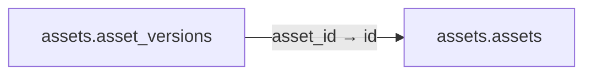

# assets.asset_versions

**Purpose:** Version/hash bất biến của GLB/ảnh/video; asset đã approve không cập nhật trong chỗ.

**Data owner:** Asset Registry · **Classification:** restricted · **Approval:** PROPOSED / NOT FROZEN · **Retention:** Review before production

## Relationship diagram — this table and every declared SQL FK neighbor

## Physical field declarations (canonical migration)
| # | Column / constraint | PostgreSQL definition |
|---:|---|---|
| 1 | `id` | `id uuid PRIMARY KEY DEFAULT gen_random_uuid()` |
| 2 | `asset_id` | `asset_id uuid NOT NULL REFERENCES assets.assets(id) ON DELETE RESTRICT` |
| 3 | `version` | `version integer NOT NULL CHECK (version > 0)` |
| 4 | `sha256` | `sha256 text NOT NULL CHECK (sha256 ~ '^[a-f0-9]{64}$')` |
| 5 | `storage_key` | `storage_key text NOT NULL` |
| 6 | `mime_type` | `mime_type text NOT NULL` |
| 7 | `status` | `status text NOT NULL DEFAULT 'draft' CHECK (status IN ('draft','review','approved','revoked'))` |
| 8 | `created_at` | `created_at timestamptz NOT NULL DEFAULT now()` |
| 9 | `UNIQUE` | `UNIQUE (asset_id,version)` |

## Outbound foreign keys (1)
- `asset_id` → [`assets.assets`](assets.assets.md) (`id`)

## Inbound foreign keys (0)
No direct inbound FK.

## Indexes / uniqueness
- `CREATE INDEX asset_versions_asset_status_idx ON assets.asset_versions(asset_id,status);`

## Runtime authorization, integrity and tests
- This table has **ENABLE + FORCE RLS with no access policies** in the proposed P0 migration. Service role grants and policy mapping cannot be activated before KingDragonHub provider/tenant authorization audit.
- All FK references are SQL-enforced; permission checks, business aggregate transitions and audit/outbox idempotency must also be tested at application layer.
- Tests: create/replay migration on disposable PostgreSQL, validate FK/unique/check errors, least-privilege access denial and no cross-tenant leakage once policies are authored.
- Historical update/delete or legal retention decisions require explicit owner review. No unapproved production migration.
