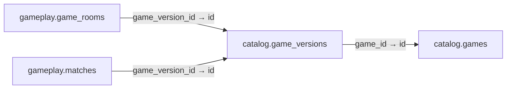

# catalog.game_versions

**Purpose:** Phiên bản luật và manifest được pin vào phòng/trận; published không sửa.

**Data owner:** Game Catalog · **Classification:** public filtered · **Approval:** PROPOSED / NOT FROZEN · **Retention:** Review before production

## Relationship diagram — this table and every declared SQL FK neighbor

## Physical field declarations (canonical migration)
| # | Column / constraint | PostgreSQL definition |
|---:|---|---|
| 1 | `id` | `id uuid PRIMARY KEY DEFAULT gen_random_uuid()` |
| 2 | `game_id` | `game_id uuid NOT NULL REFERENCES catalog.games(id) ON DELETE RESTRICT` |
| 3 | `version` | `version text NOT NULL` |
| 4 | `engine_api_version` | `engine_api_version text NOT NULL` |
| 5 | `state_schema_version` | `state_schema_version integer NOT NULL CHECK (state_schema_version > 0)` |
| 6 | `rules_sha256` | `rules_sha256 text NOT NULL CHECK (rules_sha256 ~ '^[a-f0-9]{64}$')` |
| 7 | `asset_manifest_sha256` | `asset_manifest_sha256 text NOT NULL CHECK (asset_manifest_sha256 ~ '^[a-f0-9]{64}$')` |
| 8 | `manifest` | `manifest jsonb NOT NULL` |
| 9 | `published_at` | `published_at timestamptz` |
| 10 | `created_at` | `created_at timestamptz NOT NULL DEFAULT now()` |
| 11 | `UNIQUE` | `UNIQUE (game_id,version)` |

## Outbound foreign keys (1)
- `game_id` → [`catalog.games`](catalog.games.md) (`id`)

## Inbound foreign keys (2)
- [`gameplay.game_rooms`](gameplay.game_rooms.md) via `game_version_id` → `id`
- [`gameplay.matches`](gameplay.matches.md) via `game_version_id` → `id`

## Indexes / uniqueness
Primary, uniqueness or composite constraints are defined inline in the migration.

## Runtime authorization, integrity and tests
- This table has **ENABLE + FORCE RLS with no access policies** in the proposed P0 migration. Service role grants and policy mapping cannot be activated before KingDragonHub provider/tenant authorization audit.
- All FK references are SQL-enforced; permission checks, business aggregate transitions and audit/outbox idempotency must also be tested at application layer.
- Tests: create/replay migration on disposable PostgreSQL, validate FK/unique/check errors, least-privilege access denial and no cross-tenant leakage once policies are authored.
- Historical update/delete or legal retention decisions require explicit owner review. No unapproved production migration.
