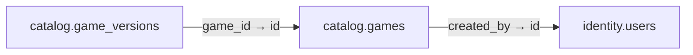

# catalog.games

**Purpose:** Game Registry; danh mục game độc lập room, kết quả, phần thưởng.

**Data owner:** Game Catalog · **Classification:** public filtered · **Approval:** PROPOSED / NOT FROZEN · **Retention:** Review before production

## Relationship diagram — this table and every declared SQL FK neighbor

## Physical field declarations (canonical migration)
| # | Column / constraint | PostgreSQL definition |
|---:|---|---|
| 1 | `id` | `id uuid PRIMARY KEY DEFAULT gen_random_uuid()` |
| 2 | `slug` | `slug text NOT NULL UNIQUE` |
| 3 | `title` | `title text NOT NULL` |
| 4 | `kind` | `kind text NOT NULL CHECK (kind IN ('board','card','puzzle','stem','coding','simulation','party'))` |
| 5 | `status` | `status text NOT NULL DEFAULT 'draft' CHECK (status IN ('draft','review','published','archived'))` |
| 6 | `created_by` | `created_by uuid NOT NULL REFERENCES identity.users(id) ON DELETE RESTRICT` |
| 7 | `created_at` | `created_at timestamptz NOT NULL DEFAULT now()` |

## Outbound foreign keys (1)
- `created_by` → [`identity.users`](identity.users.md) (`id`)

## Inbound foreign keys (1)
- [`catalog.game_versions`](catalog.game_versions.md) via `game_id` → `id`

## Indexes / uniqueness
Primary, uniqueness or composite constraints are defined inline in the migration.

## Runtime authorization, integrity and tests
- This table has **ENABLE + FORCE RLS with no access policies** in the proposed P0 migration. Service role grants and policy mapping cannot be activated before KingDragonHub provider/tenant authorization audit.
- All FK references are SQL-enforced; permission checks, business aggregate transitions and audit/outbox idempotency must also be tested at application layer.
- Tests: create/replay migration on disposable PostgreSQL, validate FK/unique/check errors, least-privilege access denial and no cross-tenant leakage once policies are authored.
- Historical update/delete or legal retention decisions require explicit owner review. No unapproved production migration.
