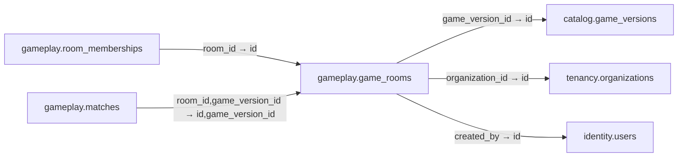

# gameplay.game_rooms

**Purpose:** Phòng chờ trước trận; một room có thể có nhiều trận rematch.

**Data owner:** Game Runtime · **Classification:** restricted · **Approval:** PROPOSED / NOT FROZEN · **Retention:** Review before production

## Relationship diagram — this table and every declared SQL FK neighbor

## Physical field declarations (canonical migration)
| # | Column / constraint | PostgreSQL definition |
|---:|---|---|
| 1 | `id` | `id uuid PRIMARY KEY DEFAULT gen_random_uuid()` |
| 2 | `game_version_id` | `game_version_id uuid NOT NULL REFERENCES catalog.game_versions(id) ON DELETE RESTRICT` |
| 3 | `organization_id` | `organization_id uuid REFERENCES tenancy.organizations(id) ON DELETE RESTRICT` |
| 4 | `created_by` | `created_by uuid NOT NULL REFERENCES identity.users(id) ON DELETE RESTRICT` |
| 5 | `visibility` | `visibility text NOT NULL DEFAULT 'private' CHECK (visibility IN ('private','organization','classroom','public'))` |
| 6 | `status` | `status text NOT NULL DEFAULT 'waiting' CHECK (status IN ('draft','waiting','ready','in_match','closed','canceled','expired'))` |
| 7 | `capacity` | `capacity integer NOT NULL CHECK (capacity BETWEEN 1 AND 100)` |
| 8 | `created_at` | `created_at timestamptz NOT NULL DEFAULT now()` |
| 9 | `UNIQUE` | `UNIQUE (id,game_version_id)` |

## Outbound foreign keys (3)
- `game_version_id` → [`catalog.game_versions`](catalog.game_versions.md) (`id`)
- `organization_id` → [`tenancy.organizations`](tenancy.organizations.md) (`id`)
- `created_by` → [`identity.users`](identity.users.md) (`id`)

## Inbound foreign keys (2)
- [`gameplay.room_memberships`](gameplay.room_memberships.md) via `room_id` → `id`
- [`gameplay.matches`](gameplay.matches.md) via `room_id,game_version_id` → `id,game_version_id`

## Indexes / uniqueness
- `CREATE INDEX room_status_idx ON gameplay.game_rooms(game_version_id,status,created_at DESC);`

## Runtime authorization, integrity and tests
- This table has **ENABLE + FORCE RLS with no access policies** in the proposed P0 migration. Service role grants and policy mapping cannot be activated before KingDragonHub provider/tenant authorization audit.
- All FK references are SQL-enforced; permission checks, business aggregate transitions and audit/outbox idempotency must also be tested at application layer.
- Tests: create/replay migration on disposable PostgreSQL, validate FK/unique/check errors, least-privilege access denial and no cross-tenant leakage once policies are authored.
- Historical update/delete or legal retention decisions require explicit owner review. No unapproved production migration.
