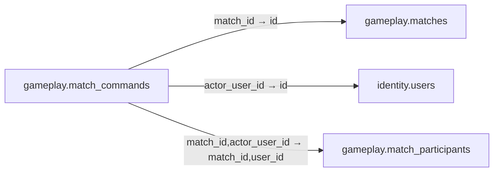

# gameplay.match_commands

**Purpose:** Lệnh đã được Game Server kiểm tra; append-only, idempotent.

**Data owner:** Game Runtime · **Classification:** restricted · **Approval:** PROPOSED / NOT FROZEN · **Retention:** Review before production

## Relationship diagram — this table and every declared SQL FK neighbor

## Physical field declarations (canonical migration)
| # | Column / constraint | PostgreSQL definition |
|---:|---|---|
| 1 | `id` | `id uuid PRIMARY KEY DEFAULT gen_random_uuid()` |
| 2 | `match_id` | `match_id uuid NOT NULL REFERENCES gameplay.matches(id) ON DELETE RESTRICT` |
| 3 | `actor_user_id` | `actor_user_id uuid NOT NULL REFERENCES identity.users(id) ON DELETE RESTRICT` |
| 4 | `seq` | `seq bigint NOT NULL CHECK (seq > 0)` |
| 5 | `idempotency_key` | `idempotency_key text NOT NULL` |
| 6 | `command_type` | `command_type text NOT NULL` |
| 7 | `payload` | `payload jsonb NOT NULL` |
| 8 | `accepted_at` | `accepted_at timestamptz NOT NULL DEFAULT now()` |
| 9 | `UNIQUE` | `UNIQUE (match_id,seq)` |
| 10 | `UNIQUE` | `UNIQUE (match_id,actor_user_id,idempotency_key)` |
| 11 | `FK (composite)` | `FOREIGN KEY (match_id,actor_user_id) REFERENCES gameplay.match_participants(match_id,user_id) ON DELETE RESTRICT` |

## Outbound foreign keys (3)
- `match_id` → [`gameplay.matches`](gameplay.matches.md) (`id`)
- `actor_user_id` → [`identity.users`](identity.users.md) (`id`)
- `match_id,actor_user_id` → [`gameplay.match_participants`](gameplay.match_participants.md) (`match_id,user_id`)

## Inbound foreign keys (0)
No direct inbound FK.

## Indexes / uniqueness
- `CREATE INDEX match_commands_recent_idx ON gameplay.match_commands(match_id,seq DESC);`

## Runtime authorization, integrity and tests
- This table has **ENABLE + FORCE RLS with no access policies** in the proposed P0 migration. Service role grants and policy mapping cannot be activated before KingDragonHub provider/tenant authorization audit.
- All FK references are SQL-enforced; permission checks, business aggregate transitions and audit/outbox idempotency must also be tested at application layer.
- Tests: create/replay migration on disposable PostgreSQL, validate FK/unique/check errors, least-privilege access denial and no cross-tenant leakage once policies are authored.
- Historical update/delete or legal retention decisions require explicit owner review. No unapproved production migration.
