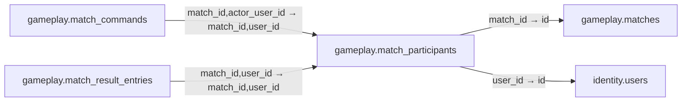

# gameplay.match_participants

**Purpose:** Người chơi/quan sát có định danh; ghế unique khi khác null.

**Data owner:** Game Runtime · **Classification:** restricted · **Approval:** PROPOSED / NOT FROZEN · **Retention:** Review before production

## Relationship diagram — this table and every declared SQL FK neighbor

## Physical field declarations (canonical migration)
| # | Column / constraint | PostgreSQL definition |
|---:|---|---|
| 1 | `id` | `id uuid PRIMARY KEY DEFAULT gen_random_uuid()` |
| 2 | `match_id` | `match_id uuid NOT NULL REFERENCES gameplay.matches(id) ON DELETE RESTRICT` |
| 3 | `user_id` | `user_id uuid NOT NULL REFERENCES identity.users(id) ON DELETE RESTRICT` |
| 4 | `seat` | `seat integer CHECK (seat >= 0)` |
| 5 | `role` | `role text NOT NULL DEFAULT 'player' CHECK (role IN ('player','host','observer'))` |
| 6 | `joined_at` | `joined_at timestamptz NOT NULL DEFAULT now()` |
| 7 | `CHECK` | `CHECK (role = 'observer' OR seat IS NOT NULL)` |
| 8 | `UNIQUE` | `UNIQUE (match_id,user_id)` |

## Outbound foreign keys (2)
- `match_id` → [`gameplay.matches`](gameplay.matches.md) (`id`)
- `user_id` → [`identity.users`](identity.users.md) (`id`)

## Inbound foreign keys (2)
- [`gameplay.match_commands`](gameplay.match_commands.md) via `match_id,actor_user_id` → `match_id,user_id`
- [`gameplay.match_result_entries`](gameplay.match_result_entries.md) via `match_id,user_id` → `match_id,user_id`

## Indexes / uniqueness
- `CREATE UNIQUE INDEX match_live_seat_unique ON gameplay.match_participants(match_id,seat) WHERE seat IS NOT NULL;`

## Runtime authorization, integrity and tests
- This table has **ENABLE + FORCE RLS with no access policies** in the proposed P0 migration. Service role grants and policy mapping cannot be activated before KingDragonHub provider/tenant authorization audit.
- All FK references are SQL-enforced; permission checks, business aggregate transitions and audit/outbox idempotency must also be tested at application layer.
- Tests: create/replay migration on disposable PostgreSQL, validate FK/unique/check errors, least-privilege access denial and no cross-tenant leakage once policies are authored.
- Historical update/delete or legal retention decisions require explicit owner review. No unapproved production migration.
