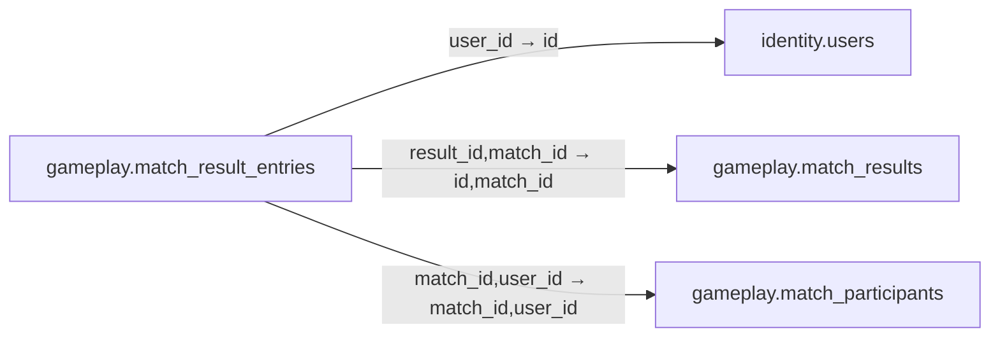

# gameplay.match_result_entries

**Purpose:** Điểm/địa vị trong kết quả, không phải bảng xếp hạng hay ví Coin.

**Data owner:** Game Runtime · **Classification:** restricted · **Approval:** PROPOSED / NOT FROZEN · **Retention:** Review before production

## Relationship diagram — this table and every declared SQL FK neighbor

## Physical field declarations (canonical migration)
| # | Column / constraint | PostgreSQL definition |
|---:|---|---|
| 1 | `id` | `id uuid PRIMARY KEY DEFAULT gen_random_uuid()` |
| 2 | `result_id` | `result_id uuid NOT NULL` |
| 3 | `match_id` | `match_id uuid NOT NULL` |
| 4 | `user_id` | `user_id uuid NOT NULL REFERENCES identity.users(id) ON DELETE RESTRICT` |
| 5 | `placement` | `placement integer CHECK (placement > 0)` |
| 6 | `score_numeric` | `score_numeric numeric(18,5)` |
| 7 | `winner` | `winner boolean NOT NULL DEFAULT false` |
| 8 | `FK (composite)` | `FOREIGN KEY (result_id,match_id) REFERENCES gameplay.match_results(id,match_id) ON DELETE RESTRICT` |
| 9 | `FK (composite)` | `FOREIGN KEY (match_id,user_id) REFERENCES gameplay.match_participants(match_id,user_id) ON DELETE RESTRICT` |
| 10 | `UNIQUE` | `UNIQUE (result_id,user_id)` |

## Outbound foreign keys (3)
- `user_id` → [`identity.users`](identity.users.md) (`id`)
- `result_id,match_id` → [`gameplay.match_results`](gameplay.match_results.md) (`id,match_id`)
- `match_id,user_id` → [`gameplay.match_participants`](gameplay.match_participants.md) (`match_id,user_id`)

## Inbound foreign keys (0)
No direct inbound FK.

## Indexes / uniqueness
Primary, uniqueness or composite constraints are defined inline in the migration.

## Runtime authorization, integrity and tests
- This table has **ENABLE + FORCE RLS with no access policies** in the proposed P0 migration. Service role grants and policy mapping cannot be activated before KingDragonHub provider/tenant authorization audit.
- All FK references are SQL-enforced; permission checks, business aggregate transitions and audit/outbox idempotency must also be tested at application layer.
- Tests: create/replay migration on disposable PostgreSQL, validate FK/unique/check errors, least-privilege access denial and no cross-tenant leakage once policies are authored.
- Historical update/delete or legal retention decisions require explicit owner review. No unapproved production migration.
