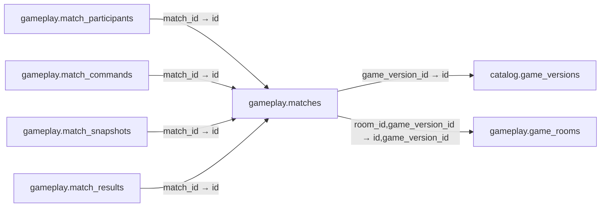

# gameplay.matches

**Purpose:** Trận cụ thể pin game_version từ room; kết quả server xác minh.

**Data owner:** Game Runtime · **Classification:** restricted · **Approval:** PROPOSED / NOT FROZEN · **Retention:** Review before production

## Relationship diagram — this table and every declared SQL FK neighbor

## Physical field declarations (canonical migration)
| # | Column / constraint | PostgreSQL definition |
|---:|---|---|
| 1 | `id` | `id uuid PRIMARY KEY DEFAULT gen_random_uuid()` |
| 2 | `room_id` | `room_id uuid NOT NULL` |
| 3 | `game_version_id` | `game_version_id uuid NOT NULL REFERENCES catalog.game_versions(id) ON DELETE RESTRICT` |
| 4 | `status` | `status text NOT NULL DEFAULT 'created' CHECK (status IN ('created','active','paused','pending_review','finalized','aborted'))` |
| 5 | `config` | `config jsonb NOT NULL DEFAULT '{}'::jsonb` |
| 6 | `started_at` | `started_at timestamptz` |
| 7 | `finalized_at` | `finalized_at timestamptz` |
| 8 | `created_at` | `created_at timestamptz NOT NULL DEFAULT now()` |
| 9 | `FK (composite)` | `FOREIGN KEY (room_id,game_version_id) REFERENCES gameplay.game_rooms(id,game_version_id) ON DELETE RESTRICT` |

## Outbound foreign keys (2)
- `game_version_id` → [`catalog.game_versions`](catalog.game_versions.md) (`id`)
- `room_id,game_version_id` → [`gameplay.game_rooms`](gameplay.game_rooms.md) (`id,game_version_id`)

## Inbound foreign keys (4)
- [`gameplay.match_participants`](gameplay.match_participants.md) via `match_id` → `id`
- [`gameplay.match_commands`](gameplay.match_commands.md) via `match_id` → `id`
- [`gameplay.match_snapshots`](gameplay.match_snapshots.md) via `match_id` → `id`
- [`gameplay.match_results`](gameplay.match_results.md) via `match_id` → `id`

## Indexes / uniqueness
- `CREATE INDEX matches_by_room_idx ON gameplay.matches(room_id,created_at DESC);`

## Runtime authorization, integrity and tests
- This table has **ENABLE + FORCE RLS with no access policies** in the proposed P0 migration. Service role grants and policy mapping cannot be activated before KingDragonHub provider/tenant authorization audit.
- All FK references are SQL-enforced; permission checks, business aggregate transitions and audit/outbox idempotency must also be tested at application layer.
- Tests: create/replay migration on disposable PostgreSQL, validate FK/unique/check errors, least-privilege access denial and no cross-tenant leakage once policies are authored.
- Historical update/delete or legal retention decisions require explicit owner review. No unapproved production migration.
