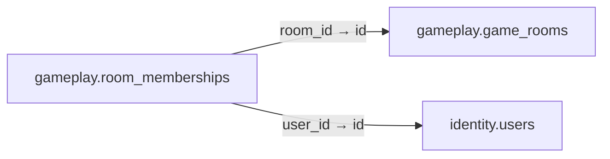

# gameplay.room_memberships

**Purpose:** Thành viên và ghế của phòng; chỉ ghế active được unique.

**Data owner:** Game Runtime · **Classification:** restricted · **Approval:** PROPOSED / NOT FROZEN · **Retention:** Review before production

## Relationship diagram — this table and every declared SQL FK neighbor

## Physical field declarations (canonical migration)
| # | Column / constraint | PostgreSQL definition |
|---:|---|---|
| 1 | `id` | `id uuid PRIMARY KEY DEFAULT gen_random_uuid()` |
| 2 | `room_id` | `room_id uuid NOT NULL REFERENCES gameplay.game_rooms(id) ON DELETE RESTRICT` |
| 3 | `user_id` | `user_id uuid NOT NULL REFERENCES identity.users(id) ON DELETE RESTRICT` |
| 4 | `seat` | `seat integer CHECK (seat >= 0)` |
| 5 | `status` | `status text NOT NULL DEFAULT 'joined' CHECK (status IN ('joined','ready','left','kicked'))` |
| 6 | `joined_at` | `joined_at timestamptz NOT NULL DEFAULT now()` |
| 7 | `UNIQUE` | `UNIQUE (room_id,user_id)` |

## Outbound foreign keys (2)
- `room_id` → [`gameplay.game_rooms`](gameplay.game_rooms.md) (`id`)
- `user_id` → [`identity.users`](identity.users.md) (`id`)

## Inbound foreign keys (0)
No direct inbound FK.

## Indexes / uniqueness
- `CREATE UNIQUE INDEX room_live_seat_unique ON gameplay.room_memberships(room_id,seat) WHERE seat IS NOT NULL AND status IN ('joined','ready');`

## Runtime authorization, integrity and tests
- This table has **ENABLE + FORCE RLS with no access policies** in the proposed P0 migration. Service role grants and policy mapping cannot be activated before KingDragonHub provider/tenant authorization audit.
- All FK references are SQL-enforced; permission checks, business aggregate transitions and audit/outbox idempotency must also be tested at application layer.
- Tests: create/replay migration on disposable PostgreSQL, validate FK/unique/check errors, least-privilege access denial and no cross-tenant leakage once policies are authored.
- Historical update/delete or legal retention decisions require explicit owner review. No unapproved production migration.
