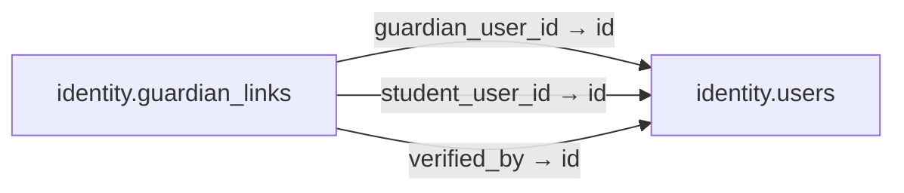

# identity.guardian_links

**Purpose:** Quan hệ người giám hộ–học sinh; xác minh trước khi có quyền xem dữ liệu.

**Data owner:** Identity/Safety · **Classification:** highly restricted · **Approval:** PROPOSED / NOT FROZEN · **Retention:** Review before production

## Relationship diagram — this table and every declared SQL FK neighbor

## Physical field declarations (canonical migration)
| # | Column / constraint | PostgreSQL definition |
|---:|---|---|
| 1 | `id` | `id uuid PRIMARY KEY DEFAULT gen_random_uuid()` |
| 2 | `guardian_user_id` | `guardian_user_id uuid NOT NULL REFERENCES identity.users(id) ON DELETE RESTRICT` |
| 3 | `student_user_id` | `student_user_id uuid NOT NULL REFERENCES identity.users(id) ON DELETE RESTRICT` |
| 4 | `status` | `status text NOT NULL DEFAULT 'pending' CHECK (status IN ('pending','verified','revoked'))` |
| 5 | `verified_by` | `verified_by uuid REFERENCES identity.users(id) ON DELETE RESTRICT` |
| 6 | `verified_at` | `verified_at timestamptz` |
| 7 | `created_at` | `created_at timestamptz NOT NULL DEFAULT now()` |
| 8 | `CHECK` | `CHECK (guardian_user_id <> student_user_id)` |
| 9 | `UNIQUE` | `UNIQUE (guardian_user_id,student_user_id)` |

## Outbound foreign keys (3)
- `guardian_user_id` → [`identity.users`](identity.users.md) (`id`)
- `student_user_id` → [`identity.users`](identity.users.md) (`id`)
- `verified_by` → [`identity.users`](identity.users.md) (`id`)

## Inbound foreign keys (0)
No direct inbound FK.

## Indexes / uniqueness
Primary, uniqueness or composite constraints are defined inline in the migration.

## Runtime authorization, integrity and tests
- This table has **ENABLE + FORCE RLS with no access policies** in the proposed P0 migration. Service role grants and policy mapping cannot be activated before KingDragonHub provider/tenant authorization audit.
- All FK references are SQL-enforced; permission checks, business aggregate transitions and audit/outbox idempotency must also be tested at application layer.
- Tests: create/replay migration on disposable PostgreSQL, validate FK/unique/check errors, least-privilege access denial and no cross-tenant leakage once policies are authored.
- Historical update/delete or legal retention decisions require explicit owner review. No unapproved production migration.
