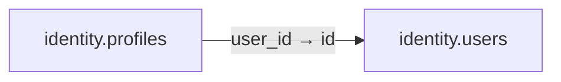

# identity.profiles

**Purpose:** Thông tin hiển thị với quyền riêng tư tách biệt danh tính đăng nhập.

**Data owner:** Identity · **Classification:** personal · **Approval:** PROPOSED / NOT FROZEN · **Retention:** Review before production

## Relationship diagram — this table and every declared SQL FK neighbor

## Physical field declarations (canonical migration)
| # | Column / constraint | PostgreSQL definition |
|---:|---|---|
| 1 | `user_id` | `user_id uuid PRIMARY KEY REFERENCES identity.users(id) ON DELETE RESTRICT` |
| 2 | `display_name` | `display_name text NOT NULL CHECK (length(btrim(display_name)) BETWEEN 1 AND 80)` |
| 3 | `locale` | `locale text NOT NULL DEFAULT 'vi-VN'` |
| 4 | `visibility` | `visibility text NOT NULL DEFAULT 'private' CHECK (visibility IN ('private','organization','public_approved'))` |
| 5 | `updated_at` | `updated_at timestamptz NOT NULL DEFAULT now()` |

## Outbound foreign keys (1)
- `user_id` → [`identity.users`](identity.users.md) (`id`)

## Inbound foreign keys (0)
No direct inbound FK.

## Indexes / uniqueness
Primary, uniqueness or composite constraints are defined inline in the migration.

## Runtime authorization, integrity and tests
- This table has **ENABLE + FORCE RLS with no access policies** in the proposed P0 migration. Service role grants and policy mapping cannot be activated before KingDragonHub provider/tenant authorization audit.
- All FK references are SQL-enforced; permission checks, business aggregate transitions and audit/outbox idempotency must also be tested at application layer.
- Tests: create/replay migration on disposable PostgreSQL, validate FK/unique/check errors, least-privilege access denial and no cross-tenant leakage once policies are authored.
- Historical update/delete or legal retention decisions require explicit owner review. No unapproved production migration.
