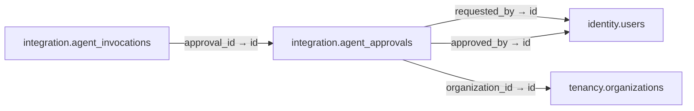

# integration.agent_approvals

**Purpose:** Human approval gắn với hash và phạm vi chính xác, có hạn dùng.

**Data owner:** AI Control · **Classification:** highly restricted · **Approval:** PROPOSED / NOT FROZEN · **Retention:** Review before production

## Relationship diagram — this table and every declared SQL FK neighbor

## Physical field declarations (canonical migration)
| # | Column / constraint | PostgreSQL definition |
|---:|---|---|
| 1 | `id` | `id uuid PRIMARY KEY DEFAULT gen_random_uuid()` |
| 2 | `requested_by` | `requested_by uuid NOT NULL REFERENCES identity.users(id) ON DELETE RESTRICT` |
| 3 | `approved_by` | `approved_by uuid NOT NULL REFERENCES identity.users(id) ON DELETE RESTRICT` |
| 4 | `organization_id` | `organization_id uuid REFERENCES tenancy.organizations(id) ON DELETE RESTRICT` |
| 5 | `tool_code` | `tool_code text NOT NULL` |
| 6 | `target_resource` | `target_resource text NOT NULL` |
| 7 | `revision_sha256` | `revision_sha256 text NOT NULL CHECK (revision_sha256 ~ '^[a-f0-9]{64}$')` |
| 8 | `scope_hash` | `scope_hash text NOT NULL CHECK (scope_hash ~ '^[a-f0-9]{64}$')` |
| 9 | `status` | `status text NOT NULL DEFAULT 'approved' CHECK (status IN ('approved','consumed','revoked','expired'))` |
| 10 | `expires_at` | `expires_at timestamptz NOT NULL` |
| 11 | `consumed_at` | `consumed_at timestamptz` |
| 12 | `created_at` | `created_at timestamptz NOT NULL DEFAULT now()` |
| 13 | `CHECK` | `CHECK (approved_by <> requested_by)` |
| 14 | `CHECK` | `CHECK ((status = 'consumed') = (consumed_at IS NOT NULL))` |

## Outbound foreign keys (3)
- `requested_by` → [`identity.users`](identity.users.md) (`id`)
- `approved_by` → [`identity.users`](identity.users.md) (`id`)
- `organization_id` → [`tenancy.organizations`](tenancy.organizations.md) (`id`)

## Inbound foreign keys (1)
- [`integration.agent_invocations`](integration.agent_invocations.md) via `approval_id` → `id`

## Indexes / uniqueness
- `CREATE INDEX agent_approvals_lookup_idx ON integration.agent_approvals(tool_code,status,expires_at);`

## Runtime authorization, integrity and tests
- This table has **ENABLE + FORCE RLS with no access policies** in the proposed P0 migration. Service role grants and policy mapping cannot be activated before KingDragonHub provider/tenant authorization audit.
- All FK references are SQL-enforced; permission checks, business aggregate transitions and audit/outbox idempotency must also be tested at application layer.
- Tests: create/replay migration on disposable PostgreSQL, validate FK/unique/check errors, least-privilege access denial and no cross-tenant leakage once policies are authored.
- Historical update/delete or legal retention decisions require explicit owner review. No unapproved production migration.
