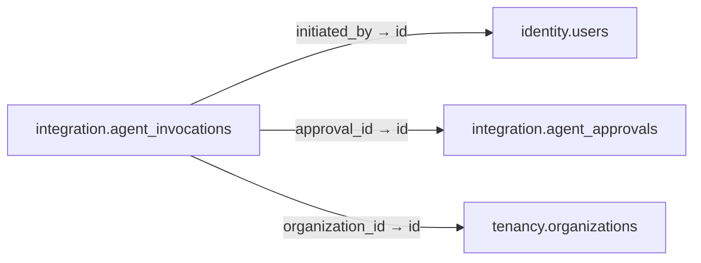

# integration.agent_invocations

**Purpose:** Một lần gọi typed tool và kết quả auditable; không cấp tool qua table này.

**Data owner:** AI Control · **Classification:** highly restricted · **Approval:** PROPOSED / NOT FROZEN · **Retention:** Review before production

## Relationship diagram — this table and every declared SQL FK neighbor

## Physical field declarations (canonical migration)
| # | Column / constraint | PostgreSQL definition |
|---:|---|---|
| 1 | `id` | `id uuid PRIMARY KEY DEFAULT gen_random_uuid()` |
| 2 | `initiated_by` | `initiated_by uuid NOT NULL REFERENCES identity.users(id) ON DELETE RESTRICT` |
| 3 | `approval_id` | `approval_id uuid REFERENCES integration.agent_approvals(id) ON DELETE RESTRICT` |
| 4 | `organization_id` | `organization_id uuid REFERENCES tenancy.organizations(id) ON DELETE RESTRICT` |
| 5 | `tool_code` | `tool_code text NOT NULL` |
| 6 | `idempotency_key` | `idempotency_key text NOT NULL` |
| 7 | `status` | `status text NOT NULL DEFAULT 'queued' CHECK (status IN ('queued','running','succeeded','failed','canceled'))` |
| 8 | `started_at` | `started_at timestamptz` |
| 9 | `finished_at` | `finished_at timestamptz` |
| 10 | `redacted_result` | `redacted_result jsonb` |
| 11 | `created_at` | `created_at timestamptz NOT NULL DEFAULT now()` |
| 12 | `UNIQUE` | `UNIQUE (initiated_by,tool_code,idempotency_key)` |

## Outbound foreign keys (3)
- `initiated_by` → [`identity.users`](identity.users.md) (`id`)
- `approval_id` → [`integration.agent_approvals`](integration.agent_approvals.md) (`id`)
- `organization_id` → [`tenancy.organizations`](tenancy.organizations.md) (`id`)

## Inbound foreign keys (0)
No direct inbound FK.

## Indexes / uniqueness
- `CREATE INDEX agent_invocations_status_idx ON integration.agent_invocations(status,created_at);`

## Runtime authorization, integrity and tests
- This table has **ENABLE + FORCE RLS with no access policies** in the proposed P0 migration. Service role grants and policy mapping cannot be activated before KingDragonHub provider/tenant authorization audit.
- All FK references are SQL-enforced; permission checks, business aggregate transitions and audit/outbox idempotency must also be tested at application layer.
- Tests: create/replay migration on disposable PostgreSQL, validate FK/unique/check errors, least-privilege access denial and no cross-tenant leakage once policies are authored.
- Historical update/delete or legal retention decisions require explicit owner review. No unapproved production migration.
