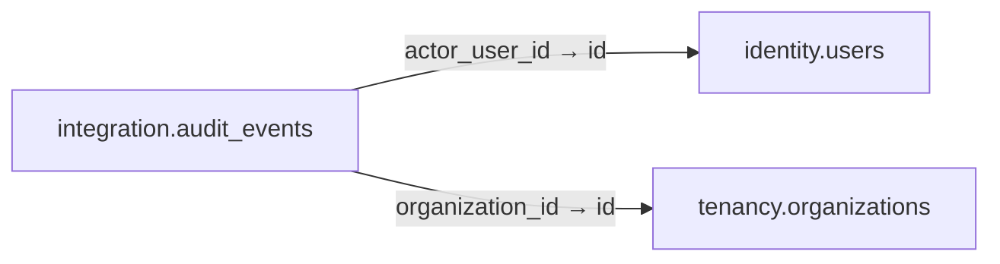

# integration.audit_events

**Purpose:** Lịch sử tác động append-only và redacted; không đưa token hoặc dữ liệu trẻ em vào payload.

**Data owner:** Platform Security · **Classification:** highly restricted · **Approval:** PROPOSED / NOT FROZEN · **Retention:** Review before production

## Relationship diagram — this table and every declared SQL FK neighbor

## Physical field declarations (canonical migration)
| # | Column / constraint | PostgreSQL definition |
|---:|---|---|
| 1 | `id` | `id uuid PRIMARY KEY DEFAULT gen_random_uuid()` |
| 2 | `actor_type` | `actor_type text NOT NULL CHECK (actor_type IN ('human','agent','service'))` |
| 3 | `actor_user_id` | `actor_user_id uuid REFERENCES identity.users(id) ON DELETE RESTRICT` |
| 4 | `organization_id` | `organization_id uuid REFERENCES tenancy.organizations(id) ON DELETE RESTRICT` |
| 5 | `action_code` | `action_code text NOT NULL` |
| 6 | `resource_type` | `resource_type text NOT NULL` |
| 7 | `resource_id` | `resource_id uuid` |
| 8 | `correlation_id` | `correlation_id uuid NOT NULL` |
| 9 | `redacted_metadata` | `redacted_metadata jsonb NOT NULL DEFAULT '{}'::jsonb` |
| 10 | `occurred_at` | `occurred_at timestamptz NOT NULL DEFAULT now()` |

## Outbound foreign keys (2)
- `actor_user_id` → [`identity.users`](identity.users.md) (`id`)
- `organization_id` → [`tenancy.organizations`](tenancy.organizations.md) (`id`)

## Inbound foreign keys (0)
No direct inbound FK.

## Indexes / uniqueness
- `CREATE INDEX audit_time_idx ON integration.audit_events(occurred_at DESC);`

## Runtime authorization, integrity and tests
- This table has **ENABLE + FORCE RLS with no access policies** in the proposed P0 migration. Service role grants and policy mapping cannot be activated before KingDragonHub provider/tenant authorization audit.
- All FK references are SQL-enforced; permission checks, business aggregate transitions and audit/outbox idempotency must also be tested at application layer.
- Tests: create/replay migration on disposable PostgreSQL, validate FK/unique/check errors, least-privilege access denial and no cross-tenant leakage once policies are authored.
- Historical update/delete or legal retention decisions require explicit owner review. No unapproved production migration.
