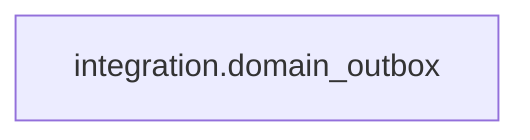

# integration.domain_outbox

**Purpose:** Thông điệp nghiệp vụ sau commit; consumer retry idempotent.

**Data owner:** Platform Integration · **Classification:** restricted · **Approval:** PROPOSED / NOT FROZEN · **Retention:** Review before production

## Relationship diagram — this table and every declared SQL FK neighbor

## Physical field declarations (canonical migration)
| # | Column / constraint | PostgreSQL definition |
|---:|---|---|
| 1 | `id` | `id uuid PRIMARY KEY DEFAULT gen_random_uuid()` |
| 2 | `aggregate_type` | `aggregate_type text NOT NULL` |
| 3 | `aggregate_id` | `aggregate_id uuid NOT NULL` |
| 4 | `event_type` | `event_type text NOT NULL` |
| 5 | `schema_version` | `schema_version integer NOT NULL CHECK (schema_version > 0)` |
| 6 | `dedupe_key` | `dedupe_key text UNIQUE` |
| 7 | `payload` | `payload jsonb NOT NULL` |
| 8 | `created_at` | `created_at timestamptz NOT NULL DEFAULT now()` |
| 9 | `published_at` | `published_at timestamptz` |

## Outbound foreign keys (0)
No direct outbound FK.

## Inbound foreign keys (0)
No direct inbound FK.

## Indexes / uniqueness
- `CREATE INDEX outbox_pending_idx ON integration.domain_outbox(created_at) WHERE published_at IS NULL;`

## Runtime authorization, integrity and tests
- This table has **ENABLE + FORCE RLS with no access policies** in the proposed P0 migration. Service role grants and policy mapping cannot be activated before KingDragonHub provider/tenant authorization audit.
- All FK references are SQL-enforced; permission checks, business aggregate transitions and audit/outbox idempotency must also be tested at application layer.
- Tests: create/replay migration on disposable PostgreSQL, validate FK/unique/check errors, least-privilege access denial and no cross-tenant leakage once policies are authored.
- Historical update/delete or legal retention decisions require explicit owner review. No unapproved production migration.
