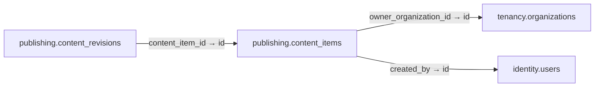

# publishing.content_items

**Purpose:** Trang/bài/khối nội dung; không trộn event/season/campaign.

**Data owner:** CMS · **Classification:** restricted · **Approval:** PROPOSED / NOT FROZEN · **Retention:** Review before production

## Relationship diagram — this table and every declared SQL FK neighbor

## Physical field declarations (canonical migration)
| # | Column / constraint | PostgreSQL definition |
|---:|---|---|
| 1 | `id` | `id uuid PRIMARY KEY DEFAULT gen_random_uuid()` |
| 2 | `owner_organization_id` | `owner_organization_id uuid REFERENCES tenancy.organizations(id) ON DELETE RESTRICT` |
| 3 | `created_by` | `created_by uuid NOT NULL REFERENCES identity.users(id) ON DELETE RESTRICT` |
| 4 | `slug` | `slug text NOT NULL` |
| 5 | `content_type` | `content_type text NOT NULL` |
| 6 | `created_at` | `created_at timestamptz NOT NULL DEFAULT now()` |

## Outbound foreign keys (2)
- `owner_organization_id` → [`tenancy.organizations`](tenancy.organizations.md) (`id`)
- `created_by` → [`identity.users`](identity.users.md) (`id`)

## Inbound foreign keys (1)
- [`publishing.content_revisions`](publishing.content_revisions.md) via `content_item_id` → `id`

## Indexes / uniqueness
- `CREATE UNIQUE INDEX content_global_slug_unique ON publishing.content_items(slug) WHERE owner_organization_id IS NULL;`
- `CREATE UNIQUE INDEX content_org_slug_unique ON publishing.content_items(owner_organization_id,slug) WHERE owner_organization_id IS NOT NULL;`

## Runtime authorization, integrity and tests
- This table has **ENABLE + FORCE RLS with no access policies** in the proposed P0 migration. Service role grants and policy mapping cannot be activated before KingDragonHub provider/tenant authorization audit.
- All FK references are SQL-enforced; permission checks, business aggregate transitions and audit/outbox idempotency must also be tested at application layer.
- Tests: create/replay migration on disposable PostgreSQL, validate FK/unique/check errors, least-privilege access denial and no cross-tenant leakage once policies are authored.
- Historical update/delete or legal retention decisions require explicit owner review. No unapproved production migration.
