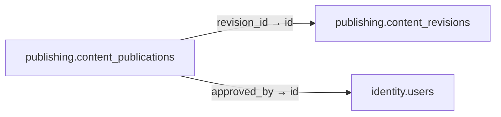

# publishing.content_publications

**Purpose:** Con trỏ phát hành và cửa sổ thời gian; phải được phê duyệt đúng revision.

**Data owner:** CMS · **Classification:** restricted · **Approval:** PROPOSED / NOT FROZEN · **Retention:** Review before production

## Relationship diagram — this table and every declared SQL FK neighbor

## Physical field declarations (canonical migration)
| # | Column / constraint | PostgreSQL definition |
|---:|---|---|
| 1 | `id` | `id uuid PRIMARY KEY DEFAULT gen_random_uuid()` |
| 2 | `revision_id` | `revision_id uuid NOT NULL REFERENCES publishing.content_revisions(id) ON DELETE RESTRICT` |
| 3 | `approved_by` | `approved_by uuid NOT NULL REFERENCES identity.users(id) ON DELETE RESTRICT` |
| 4 | `channel` | `channel text NOT NULL` |
| 5 | `target_policy` | `target_policy jsonb NOT NULL DEFAULT '{}'::jsonb` |
| 6 | `priority` | `priority integer NOT NULL DEFAULT 0` |
| 7 | `starts_at` | `starts_at timestamptz NOT NULL` |
| 8 | `ends_at` | `ends_at timestamptz` |
| 9 | `status` | `status text NOT NULL DEFAULT 'scheduled' CHECK (status IN ('scheduled','active','expired','revoked'))` |
| 10 | `created_at` | `created_at timestamptz NOT NULL DEFAULT now()` |
| 11 | `CHECK` | `CHECK (ends_at IS NULL OR ends_at > starts_at)` |

## Outbound foreign keys (2)
- `revision_id` → [`publishing.content_revisions`](publishing.content_revisions.md) (`id`)
- `approved_by` → [`identity.users`](identity.users.md) (`id`)

## Inbound foreign keys (0)
No direct inbound FK.

## Indexes / uniqueness
- `CREATE INDEX content_publication_lookup_idx ON publishing.content_publications(channel,status,starts_at,ends_at,priority DESC);`

## Runtime authorization, integrity and tests
- This table has **ENABLE + FORCE RLS with no access policies** in the proposed P0 migration. Service role grants and policy mapping cannot be activated before KingDragonHub provider/tenant authorization audit.
- All FK references are SQL-enforced; permission checks, business aggregate transitions and audit/outbox idempotency must also be tested at application layer.
- Tests: create/replay migration on disposable PostgreSQL, validate FK/unique/check errors, least-privilege access denial and no cross-tenant leakage once policies are authored.
- Historical update/delete or legal retention decisions require explicit owner review. No unapproved production migration.
