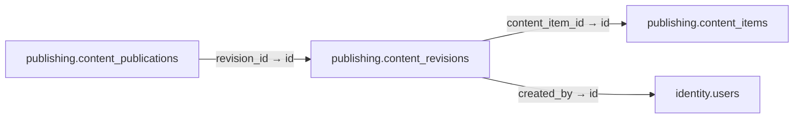

# publishing.content_revisions

**Purpose:** Nội dung theo revision, hash và người tạo, không ghi đè bản cũ.

**Data owner:** CMS · **Classification:** restricted · **Approval:** PROPOSED / NOT FROZEN · **Retention:** Review before production

## Relationship diagram — this table and every declared SQL FK neighbor

## Physical field declarations (canonical migration)
| # | Column / constraint | PostgreSQL definition |
|---:|---|---|
| 1 | `id` | `id uuid PRIMARY KEY DEFAULT gen_random_uuid()` |
| 2 | `content_item_id` | `content_item_id uuid NOT NULL REFERENCES publishing.content_items(id) ON DELETE RESTRICT` |
| 3 | `revision` | `revision integer NOT NULL CHECK (revision > 0)` |
| 4 | `locale` | `locale text NOT NULL DEFAULT 'vi-VN'` |
| 5 | `schema_version` | `schema_version integer NOT NULL DEFAULT 1 CHECK (schema_version > 0)` |
| 6 | `body` | `body jsonb NOT NULL` |
| 7 | `body_sha256` | `body_sha256 text NOT NULL CHECK (body_sha256 ~ '^[a-f0-9]{64}$')` |
| 8 | `created_by` | `created_by uuid NOT NULL REFERENCES identity.users(id) ON DELETE RESTRICT` |
| 9 | `created_at` | `created_at timestamptz NOT NULL DEFAULT now()` |
| 10 | `UNIQUE` | `UNIQUE (content_item_id,locale,revision)` |

## Outbound foreign keys (2)
- `content_item_id` → [`publishing.content_items`](publishing.content_items.md) (`id`)
- `created_by` → [`identity.users`](identity.users.md) (`id`)

## Inbound foreign keys (1)
- [`publishing.content_publications`](publishing.content_publications.md) via `revision_id` → `id`

## Indexes / uniqueness
Primary, uniqueness or composite constraints are defined inline in the migration.

## Runtime authorization, integrity and tests
- This table has **ENABLE + FORCE RLS with no access policies** in the proposed P0 migration. Service role grants and policy mapping cannot be activated before KingDragonHub provider/tenant authorization audit.
- All FK references are SQL-enforced; permission checks, business aggregate transitions and audit/outbox idempotency must also be tested at application layer.
- Tests: create/replay migration on disposable PostgreSQL, validate FK/unique/check errors, least-privilege access denial and no cross-tenant leakage once policies are authored.
- Historical update/delete or legal retention decisions require explicit owner review. No unapproved production migration.
