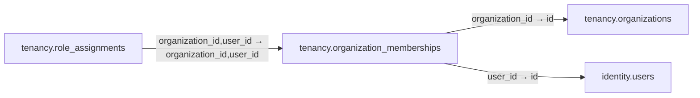

# tenancy.organization_memberships

**Purpose:** Thành viên trong tổ chức, có trạng thái riêng và FK toàn vẹn.

**Data owner:** Tenancy · **Classification:** restricted · **Approval:** PROPOSED / NOT FROZEN · **Retention:** Review before production

## Relationship diagram — this table and every declared SQL FK neighbor

## Physical field declarations (canonical migration)
| # | Column / constraint | PostgreSQL definition |
|---:|---|---|
| 1 | `organization_id` | `organization_id uuid NOT NULL REFERENCES tenancy.organizations(id) ON DELETE RESTRICT` |
| 2 | `user_id` | `user_id uuid NOT NULL REFERENCES identity.users(id) ON DELETE RESTRICT` |
| 3 | `status` | `status text NOT NULL DEFAULT 'invited' CHECK (status IN ('invited','active','suspended','left'))` |
| 4 | `joined_at` | `joined_at timestamptz` |
| 5 | `created_at` | `created_at timestamptz NOT NULL DEFAULT now()` |
| 6 | `PK (composite)` | `PRIMARY KEY (organization_id,user_id)` |

## Outbound foreign keys (2)
- `organization_id` → [`tenancy.organizations`](tenancy.organizations.md) (`id`)
- `user_id` → [`identity.users`](identity.users.md) (`id`)

## Inbound foreign keys (1)
- [`tenancy.role_assignments`](tenancy.role_assignments.md) via `organization_id,user_id` → `organization_id,user_id`

## Indexes / uniqueness
- `CREATE INDEX memberships_by_user_idx ON tenancy.organization_memberships(user_id,status);`

## Runtime authorization, integrity and tests
- This table has **ENABLE + FORCE RLS with no access policies** in the proposed P0 migration. Service role grants and policy mapping cannot be activated before KingDragonHub provider/tenant authorization audit.
- All FK references are SQL-enforced; permission checks, business aggregate transitions and audit/outbox idempotency must also be tested at application layer.
- Tests: create/replay migration on disposable PostgreSQL, validate FK/unique/check errors, least-privilege access denial and no cross-tenant leakage once policies are authored.
- Historical update/delete or legal retention decisions require explicit owner review. No unapproved production migration.
