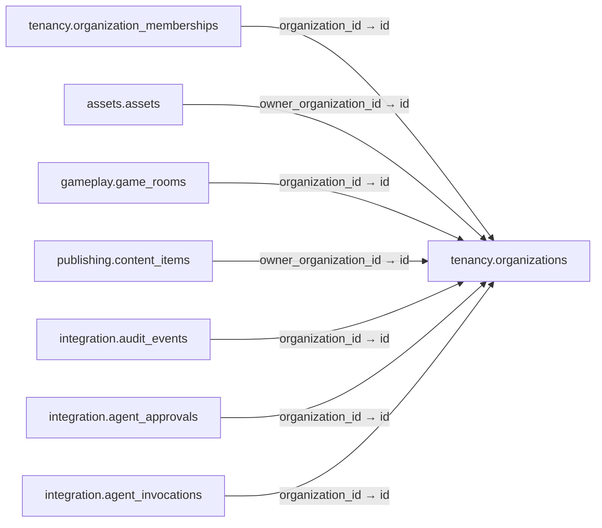

# tenancy.organizations

**Purpose:** Trường, CLB hoặc đơn vị vận hành; tách khỏi người dùng toàn cục.

**Data owner:** Tenancy · **Classification:** restricted · **Approval:** PROPOSED / NOT FROZEN · **Retention:** Review before production

## Relationship diagram — this table and every declared SQL FK neighbor

## Physical field declarations (canonical migration)
| # | Column / constraint | PostgreSQL definition |
|---:|---|---|
| 1 | `id` | `id uuid PRIMARY KEY DEFAULT gen_random_uuid()` |
| 2 | `slug` | `slug text NOT NULL UNIQUE` |
| 3 | `display_name` | `display_name text NOT NULL` |
| 4 | `kind` | `kind text NOT NULL CHECK (kind IN ('school','center','club','organizer','other'))` |
| 5 | `status` | `status text NOT NULL DEFAULT 'active' CHECK (status IN ('active','suspended','archived'))` |
| 6 | `created_at` | `created_at timestamptz NOT NULL DEFAULT now()` |

## Outbound foreign keys (0)
No direct outbound FK.

## Inbound foreign keys (7)
- [`tenancy.organization_memberships`](tenancy.organization_memberships.md) via `organization_id` → `id`
- [`assets.assets`](assets.assets.md) via `owner_organization_id` → `id`
- [`gameplay.game_rooms`](gameplay.game_rooms.md) via `organization_id` → `id`
- [`publishing.content_items`](publishing.content_items.md) via `owner_organization_id` → `id`
- [`integration.audit_events`](integration.audit_events.md) via `organization_id` → `id`
- [`integration.agent_approvals`](integration.agent_approvals.md) via `organization_id` → `id`
- [`integration.agent_invocations`](integration.agent_invocations.md) via `organization_id` → `id`

## Indexes / uniqueness
Primary, uniqueness or composite constraints are defined inline in the migration.

## Runtime authorization, integrity and tests
- This table has **ENABLE + FORCE RLS with no access policies** in the proposed P0 migration. Service role grants and policy mapping cannot be activated before KingDragonHub provider/tenant authorization audit.
- All FK references are SQL-enforced; permission checks, business aggregate transitions and audit/outbox idempotency must also be tested at application layer.
- Tests: create/replay migration on disposable PostgreSQL, validate FK/unique/check errors, least-privilege access denial and no cross-tenant leakage once policies are authored.
- Historical update/delete or legal retention decisions require explicit owner review. No unapproved production migration.
