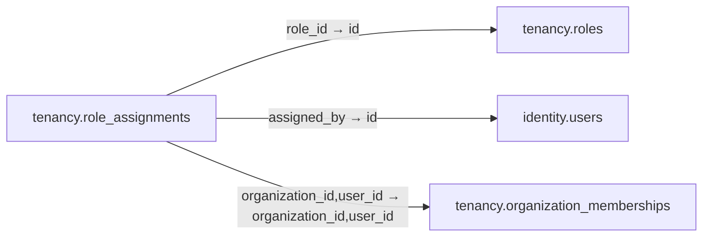

# tenancy.role_assignments

**Purpose:** Phân vai trò theo membership trong tổ chức, không tự cấp quyền qua SSO claim.

**Data owner:** IAM · **Classification:** highly restricted · **Approval:** PROPOSED / NOT FROZEN · **Retention:** Review before production

## Relationship diagram — this table and every declared SQL FK neighbor

## Physical field declarations (canonical migration)
| # | Column / constraint | PostgreSQL definition |
|---:|---|---|
| 1 | `organization_id` | `organization_id uuid NOT NULL` |
| 2 | `user_id` | `user_id uuid NOT NULL` |
| 3 | `role_id` | `role_id uuid NOT NULL REFERENCES tenancy.roles(id) ON DELETE RESTRICT` |
| 4 | `assigned_by` | `assigned_by uuid REFERENCES identity.users(id) ON DELETE RESTRICT` |
| 5 | `assigned_at` | `assigned_at timestamptz NOT NULL DEFAULT now()` |
| 6 | `PK (composite)` | `PRIMARY KEY (organization_id,user_id,role_id)` |
| 7 | `FK (composite)` | `FOREIGN KEY (organization_id,user_id) REFERENCES tenancy.organization_memberships(organization_id,user_id) ON DELETE RESTRICT` |

## Outbound foreign keys (3)
- `role_id` → [`tenancy.roles`](tenancy.roles.md) (`id`)
- `assigned_by` → [`identity.users`](identity.users.md) (`id`)
- `organization_id,user_id` → [`tenancy.organization_memberships`](tenancy.organization_memberships.md) (`organization_id,user_id`)

## Inbound foreign keys (0)
No direct inbound FK.

## Indexes / uniqueness
- `CREATE INDEX role_assignments_lookup_idx ON tenancy.role_assignments(user_id,organization_id);`

## Runtime authorization, integrity and tests
- This table has **ENABLE + FORCE RLS with no access policies** in the proposed P0 migration. Service role grants and policy mapping cannot be activated before KingDragonHub provider/tenant authorization audit.
- All FK references are SQL-enforced; permission checks, business aggregate transitions and audit/outbox idempotency must also be tested at application layer.
- Tests: create/replay migration on disposable PostgreSQL, validate FK/unique/check errors, least-privilege access denial and no cross-tenant leakage once policies are authored.
- Historical update/delete or legal retention decisions require explicit owner review. No unapproved production migration.
