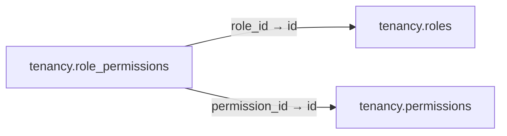

# tenancy.role_permissions

**Purpose:** Quan hệ N–N giữa vai trò và quyền.

**Data owner:** IAM · **Classification:** restricted · **Approval:** PROPOSED / NOT FROZEN · **Retention:** Review before production

## Relationship diagram — this table and every declared SQL FK neighbor

## Physical field declarations (canonical migration)
| # | Column / constraint | PostgreSQL definition |
|---:|---|---|
| 1 | `role_id` | `role_id uuid NOT NULL REFERENCES tenancy.roles(id) ON DELETE RESTRICT` |
| 2 | `permission_id` | `permission_id uuid NOT NULL REFERENCES tenancy.permissions(id) ON DELETE RESTRICT` |
| 3 | `PK (composite)` | `PRIMARY KEY (role_id,permission_id)` |

## Outbound foreign keys (2)
- `role_id` → [`tenancy.roles`](tenancy.roles.md) (`id`)
- `permission_id` → [`tenancy.permissions`](tenancy.permissions.md) (`id`)

## Inbound foreign keys (0)
No direct inbound FK.

## Indexes / uniqueness
Primary, uniqueness or composite constraints are defined inline in the migration.

## Runtime authorization, integrity and tests
- This table has **ENABLE + FORCE RLS with no access policies** in the proposed P0 migration. Service role grants and policy mapping cannot be activated before KingDragonHub provider/tenant authorization audit.
- All FK references are SQL-enforced; permission checks, business aggregate transitions and audit/outbox idempotency must also be tested at application layer.
- Tests: create/replay migration on disposable PostgreSQL, validate FK/unique/check errors, least-privilege access denial and no cross-tenant leakage once policies are authored.
- Historical update/delete or legal retention decisions require explicit owner review. No unapproved production migration.
