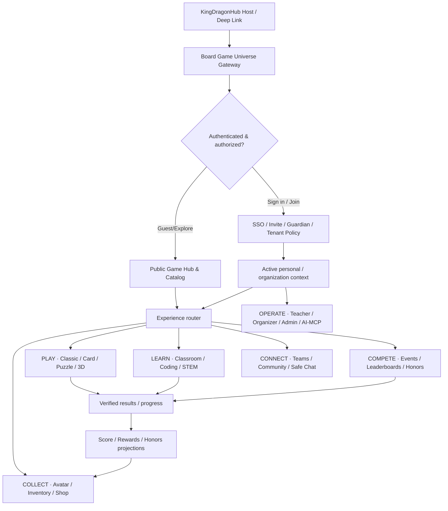
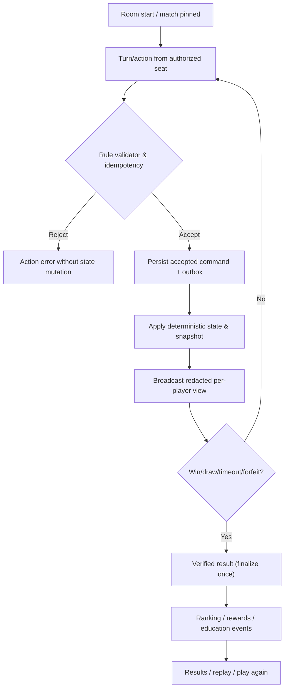

# End-to-End Application & Operations Flows V2
**Owner:** Product Architecture / Experience · **Status:** Proposed · **Coverage:** KingDragonHub → Play / Learn / Compete / Collect / Connect / Operate.
**Design principles:** Tenant-aware, versioned game modules, recoverable state, privacy-first minors, auditable commerce and Agent writes.

## 0. Platform entry and navigation

## Shared design invariants
- All users have one global identity with context-specific memberships/roles/entitlements. Guest status is restricted and not silently converted into a permanent child account.
- Public discovery is permission-filtered; authorization is **server-side** for every operation. Feature visibility ≠ permission to execute.
- Every game match pins game_version, ruleset version/hash, player view policies and scoring policy; camera/UI state is not the authoritative state.
- Scores, learning rubric, XP, coins and Hall of Fame honors are **separate data types**; no paid cosmetics affect competitive outcomes.
- PII, minor classroom records, chat moderation evidence and commerce receipts have different retention and access rules.
- All irreversible writes use idempotency, verified expected revision and audit/outbox, not direct browser/Agent DB mutation.

## F01 — Visitor, account, SSO, age/policy and initial onboarding
**Actor:** anonymous visitor, adult, invited student, teacher, guardian; **State:** ANONYMOUS → INVITED/REGISTERED → VERIFIED_AS_REQUIRED → ACTIVE or LIMITED/SUSPENDED.
1. Deep link / host navbar → Game Hub (public catalog/landing; age-appropriate discovery).
2. Choose guest demo or login; if sign-in, exchange trusted KingDragonHub SSO/OIDC token or authorized local identity provider.
3. Profile setup nickname/avatar, locale/accessibility and account-type/age-band policy with only minimum needed fields. For student, enroll via teacher roster code and school/guardian authorization procedure where legally applicable.
4. Resolve user profile and tenant memberships; choose Personal Space or school/club context; show context-specific navigation.
5. Consent/policy collection separated from game preferences and commerce permission. Grant child safety defaults (stranger DM OFF, external trading OFF).
6. Handle failed login, expired link, revoked invite, existing account merge/duplicates, missing guardian authorization, reset/recovery, rejoin on new device; do not duplicate identities.
**Data:** users, linked_identities, profile, guardian_relationships/consents candidate, organization_memberships, policy acknowledgments, auth sessions. **Gaps:** account recovery, identity-link conflict, policy/consent, tenant switcher, data export/delete.

## F02 — Game discovery and playmode selection
**Actor:** visitor/player/student.
1. Home → search/facets (genre, player count, duration, learning skill, 2D/3D, device, language) → game detail.
2. Detail shows game rules/tutorial video, availability, version, age policy, entitlement, required hardware, supported modes and accessibility.
3. Choose solo bot, local pass-and-play, private room, public matching, classroom assignment or tournament; disabled modes show reason/action.
4. Store selected mode/config and return URL/room info without granting match result.
**Data:** game catalog/version, game_capabilities, region/visibility/rights, user game preferences, entitlement/launch policy.
**Exceptions:** game down/version retired/device cannot run WebGL/age restricted/expired license.

## F03 — Private room and matchmaking
**Actor:** host, invited player, spectator (restricted).
1. Host config game_version (locked at start), room rules, seats/teams, invite visibility, join code/QR, reconnect window and spectators.
2. Members join, permission+seat checks; ready/leave/kick controls; bot-fill if allowed.
3. Start only when minimum players ready, seed/config stored; creates match from room; reconnect/late join policy explicit.
4. Public ranked: enter queue by game/mode/region/skill, confirm match, timeouts and abandon penalty separate.
**States:** DRAFT → WAITING → READY → IN_MATCH → CLOSED, with room CANCELED/EXPIRED; connection ONLINE/OFFLINE flag orthogonal.
**Data:** game_rooms, room_memberships, invitations or join token, matches, matchmaking entries.
**Exceptions:** simultaneous last-seat joins, duplicate join token, room host leaves, room migration/restart.

## F04 — Generic match loop and verified completion

**Data:** matches, match_participants, match_commands/events/snapshots, result entries, replay artifacts, score_records. **Cases:** disconnection, duplicated move, simultaneous actions, server restart, draw, abandoned room, appeal/correction, private hand secrecy.

## F05 — Eco City Lab persistent 3D cooperative play
**Actor:** player/team/teacher.
1. Room/assignment → choose scenario/board size (6x6 tutorial; 10x10 standard; 16x16+ advanced).
2. In team, inspect resource HUD, cards, roles and common city; select card → rotate and ghost-preview legal footprint.
3. Submit proposal + optional vote; rule server checks turn/team authorization, cash, resource prerequisites, tile reservation and footprint.
4. On accepted build: persist command/versioned simulation state, update saved world where enabled, send confirmed events; Three.js client renders Blockbench GLB and VFX.
5. Simulate resource changes; show explanation of trade-off; next turn; review STEM decision/evidence; save/resume city outside match lifecycle.
**Data:** world, world revisions/chunks/entities, scenario, build card version, action/vote records, rubric evidence, asset_version references.
**Exceptions:** proposal vote tie, insufficient resource, GLB missing/fallback, state migration, canvas no-WebGL, offline classroom recovery.

## F06 — Student joins classroom and completes assignment
1. Teacher/admin provides roster invite and class/assignment QR; student authenticates or uses controlled learner identity with consent/policy.
2. See assignment objectives, difficulty, tutorial, time and team/individual mode.
3. Join classroom session, play/generate submissions, leave/reconnect, request assistance, reflect on strategy and submit.
4. Teacher reviews evidence with rubric version, feedback and optional resubmission; student sees own result in private space.
**Data:** classes, enrollments, assignments, classroom_sessions, learner attempts, evidence, assessments, rubrics.
**Exceptions:** reused join code, student switches classes, assignment closed, multiple submissions, learner never returns, off-device data.

## F07 — Teacher classroom administration
1. Teacher logs in with organization context → school/class switcher → create class or import approved roster.
2. Pick games/learning objectives and create assignment from immutable problem/mission version; configure differentiation.
3. Divide class into teams randomly/manually/balanced; choose leader/captain roles and team rotation.
4. Start timed live lesson, display code/QR; see group status, teacher-controlled pause, intervene, exclude unsafe chat.
5. End lesson, grade rubric, share appropriate feedback, export aggregate/per-student reports with access controls.
6. Archive school year/roll over class, revoke invites, handle parent/guardian requests and data retention.
**Data:** organizational units, classrooms/enrollments, teacher assignment, lesson, assignments, team membership snapshots, classroom sessions and assessment audit.

## F08 — Social: friends, teams, channel chat and moderation
1. User enters permitted team/community; safe friend invite requires consent/policy for minors; no open stranger DM.
2. Join class/team/game channel, send allowed quick-chat or moderated text, react/vote/report. Fanout only to authorized membership.
3. Moderation: report → queue → scoped reviewer sees permitted evidence → warning/mute/remove/takedown → appeal/escalation and audited closure.
4. Leave team/deactivate or delete chat per retention; revoked school membership removes future access.
**Data:** teams, team_memberships, channels, channel_members, messages, report_cases/moderation_actions, blocking/mutes, safety audit.
**Exceptions:** message sent at time of membership revocation, deleted message, restricted files, spam, sensitive child abuse escalation.

## F09 — Event lifecycle & participation
1. Organizer drafts event: description, registration window, age/campus region eligibility, team requirements, venue/timezone, event terms.
2. Content/organizer approval → public or targeted publication → user/team registration, guardian authorization where necessary.
3. Capacity enforcement + waitlist, check-in and confirmation → activity/mission/tournament session.
4. Event completed/canceled/postponed, notifications to affected audience, refund of *virtual* entry charges if any (not initially planned), closure report/archive.
**Data:** event_programs, events, registrations, waitlist/check-in (P1 tables), event publications, notifications.

## F10 — Tournament / ranking / appeals
1. Event→ tournament config: format (round robin / Swiss / single elimination / score attack), divisions, scoring seed, tiebreak and referee roles.
2. Validate eligible teams, check-in → publish bracket/fixtures → create authorized match rooms.
3. Match finalizes verified result → organizer receives provisional standings; disputes can hold affected result.
4. Referee decision corrects score with audit and recompute → frozen final standings, eligible trophy grants and nominations.
5. Public leaderboard filters game/mode/team/period; student private competency rubrics stay hidden.
**Data:** tournament, stages, fixtures, match results, score ledger, ranking metric versions, ranking entries, freeze, disputes.
**Exceptions:** no show, BYE, disconnected opponent, tied event, corrupted match replay, late appeal.

## F11 — Hall of Fame and award claim
1. Source = finalized tournament outcome / reviewed learning project / qualifying contribution.
2. Create honor nomination with evidence; verification, editorial and child visibility approval.
3. Publish season- and category-specific recognition gallery; selected award/collectible granted through item reward service.
4. Profile optionally showcases award, avatar frame, trophy; revoke public display on privacy request without rewriting verified event history.
**Data:** honors, honors nominations/reviews, achievement grants, profile showcase preferences, publication revisions.
**Exceptions:** student cannot be publicly displayed, corrected standings, duplicate award, evidence revoked.

## F12 — Progression, reward and achievement
1. Verified event passes versioned reward policy and economy caps; create immutable grant transaction (no client minting).
2. Grant XP for progress, virtual Coins for approved economy and item instance from inventory; notify user.
3. Profile shows skills/achievements privately where needed, awards/public show only with permission.
4. Rollback/correct source result through compensating grant, no destructive delete.
**Data:** achievement_definitions/grants, currencies, ledger, grants, inventory events, outbox.
**Exceptions:** replay duplicate, game score tampering, currency limit/expiry, dispute hold.

## F13 — Official Shop and wallet transaction
1. Shop discovery filtered by age, tenant, item compatibility, shop offer revision, verified status.
2. Item detail → 2D/3D preview → fixed earned-coin price and restrictions → confirm.
3. Backend locks balance/stock and validates eligibility; atomic ledger debit / order / inventory grant / outbox.
4. Show receipt, update inventory and notification; restore if network drops; resubmission same idempotency returns same receipt.
**Data:** item_catalog/version/edition, shop_offers/revisions, shop_orders, ledger_accounts/entries, inventory_instances/stacks.
**Exceptions:** insufficient coins, sold out, concurrent purchase, pending transaction, no-WebGL preview.

## F14 — Wardrobe, mascot, pet, personalization
1. Profile→ closet/inventory → avatar editor and current preset.
2. Select body base and hair/face/head/arms/hands/legs/feet, suit, pet, background/frame; check rig/slot conflict.
3. Preview with idle/walk/win animation, hide occluded parts and apply accessible fallback; save preferred loadout.
4. Cross-game presentation uses rig+item asset versions but never alters competitive hitbox or learning score.
**Data:** avatar presets, loadout, loadout items, inventory ownership, rig compat, profile decorations.
**Exceptions:** missing item, transferred/revoked item, bad GLB, incompatible costume, expired license.

## F15 — Player Marketplace (gated future)
1. Eligible adult sees market listings; minor and restricted org policies prohibit browsing/participating where required.
2. Seller selects tradeable owned instance, sets fixed internal-credit price; service places item under exclusive listing hold.
3. Buyer confirms listing version and eligibility; reserve and atomic settlement transfers ownership and balanced currency entries.
4. Receipts, moderator review and dispute/compensation available. No cash-out or strangers' messaging needed.
**Data:** trade listings, reservations, settlements, ledger, inventory events, moderation and sanctions.
**Exceptions:** simultaneous buyers, seller account suspension, listing expiration, reserve TTL, refund, item fraud.

## F16 — Coding Arena: Blockly, text coding, robot 2D/3D
1. Browse problems/learning tracks and game mode, tutorial and difficulty.
2. Use Blockly workspace or text editor; client preview (safe/simulated) shows step-by-step robot state.
3. Submit source/workspace version → secure judge queue → isolated runner with test limits; result/verdict visible.
4. Provide feedback/test evidence, optional revise/retry, leaderboard updates only verified submissions and rubric policy.
5. Contest locks problem version, seed, allowed languages and judge image; rejudge records correction not overwrite.
**Data:** problem versions, languages, private/public testsets, submissions, judge runs, verdict, game match association.
**Exceptions:** malicious/timeout code, submission abuse, judge outage, unfair test revision, academic plagiarism review.

## F17 — CMS, seasonal theme, announcements and content schedule
1. Content editor drafts page blocks, collection, theme, banner, seasonal reward and announcements.
2. Validate availability, language, tenant/audience/age, date/timezone, license, token/accessibility, conflicting campaign slot.
3. Approver signs exact revision; scheduler publishes at time without running AI; user receives eligible content with safe fallback.
4. Period expiry, withdrawal/rollback and audit; notification preferences and delayed delivery.
**Data:** content revisions/publications, theme revisions, campaign schedule, feature flags, notification jobs and deliveries.
**Exceptions:** schedule conflict, expired linked game, out-of-stock offer, wrong tenant, missing consent, stale approval.

## F18 — Admin, customer support, safety & rights requests
1. Operator selects scoped management workspace; authorization records real actor and reason.
2. User support ticket: identity recovery, purchase issue, lost item, match dispute, bug, accessibility and account moderation.
3. Verify evidence, assign case, SLA, limited-access inquiry, remediation through application services/compensating records, close + CSAT.
4. Privacy/guardian: export/restrict/delete/anonymize with dependency graph and legal retention exceptions; perform backup re-deletion policy.
**Data (gap):** support tickets/case events, policy consents, guardian relation, data requests, deletions, audits, retention holds.
**Exceptions:** forged guardian identity, overlapping case scopes, unlawful data exposure and irreversible recovery.

## F19 — AI Agent / MCP operation, workflow and release
1. Human or approved schedule triggers Agent with principal, tenant, scopes, budget, artifact versions and selected tools.
2. Agent reads approved docs/resources, creates proposal/plan; draft changes via typed MCP tools using application services.
3. QA preview/diff and policy evaluation; high-risk change requires human approval bound to exact revision.
4. Durable worker executes scheduled steps idempotently; notify completion/failure, append audit and provide rollback/cancel.
5. Software code work: edit branch → PR → CI tests → reviewer approval → release staging → gated production deploy. Never direct auto-write into `main` or DB.
**Data:** agent definitions/runs, MCP tools/grants/invocations, workflow revisions/runs/steps, approvals, evidence artifacts, audit and outbox.
**Exceptions:** prompt injection, scope escalation, stale approval, execution timeout, retry, external API outage, secrets leak.

## F20 — Creator, publishing & long-term lifecycle (P2)
1. Approved creator starts from template/asset catalog, adds rules/quiz/card problems/3D level under schema.
2. Preview sandbox and automated safety/copyright checks → submit moderation/publisher review → versioned release.
3. Catalog discoverability and entitlement handled by platform, not creator-controlled authentication or scoring.
4. Deprecate, patch, migrate saved state, withdraw inappropriate content; replay and published version artifacts remain traceable.
**Data:** creator projects/revisions/publications, rights, game templates, content submissions/moderation.
**Exceptions:** revoked art license, malicious scripts, schema migration and creator account deletion.

## Cross-flow failure policies
- **Unauthorized/age-blocked** → explain restricted action and safe alternatives without leaking other users' data.
- **Expired content/rules** → pin active match version, display unavailable to new rooms.
- **Network lost** → reconnect with session token; do not create duplicate move/order; show authoritative status.
- **Cancelled/rescheduled event** → recorded state change, notify eligible participants and update fixture and league policy.
- **Disputed result** → provisional/frozen scope, honor publication holds until confirmed.
- **User deletion** → redact public projections, preserve only legally necessary anonymized accounting/audit.
- **Service outage** → safe degraded state, preserve durable jobs, no phantom coin/item results.
